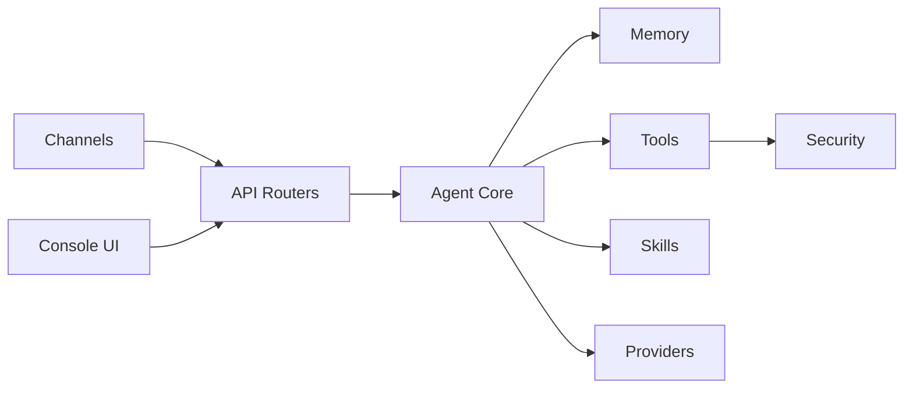

# agentscope-ai/QwenPaw

> Self-hosted, multi-channel personal AI assistant extensible through skills, for individual use.

## The problem
Consumer AI assistants keep your data on their side and do not plug into your messaging apps or scheduled tasks.

## What it actually does
Python backend (`qwenpaw app`) + React console on port 8088, TUI and Tauri desktop app (beta).
ReAct agent loop, three-level memory (ReMe), multi-agent, cron, MCP, skills and plugins.
DingTalk, Lark, WeChat, Discord, Telegram, iMessage, QQ adapters; cloud or local providers (llama.cpp, Ollama, LM Studio), QwenPaw-Flash 2B/4B/9B models.
Kernel sandbox, Tool Guard, File Guard, skill scanner, access policy.

## How it is wired


## Trying it
```bash
pip install qwenpaw
qwenpaw init --defaults
qwenpaw app
docker pull agentscope/qwenpaw:latest
```

## Cost and gotchas
An API key is needed for a cloud LLM (the bill is on you); free locally. Anonymous telemetry is accepted by default with `--defaults`. Python 3.11 to 3.13.

## What it is not
Not an agent framework to embed in your code (it is an app). Channels are mostly oriented toward the Chinese ecosystem; the desktop app is still in beta and not notarized on macOS.

## Alternatives
None named in the README.

## For you
Worth testing if you want a local personal agent with cron and MCP; disable telemetry at init.
