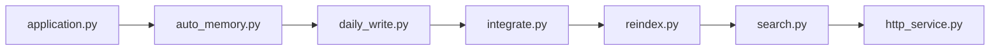

# agentscope-ai/ReMe

> Local Markdown knowledge base that gives AI agents a durable, shared memory.

## The problem
Agents forget from one session to the next, and their memory remains opaque and not editable by the user.

## What it actually does
Stores memory as Markdown files with frontmatter and wiki links in a workspace (`session/`, `resource/`, `daily/`, `digest/`). Tasks capture conversations (`auto_memory`), import resources, index and consolidate into durable knowledge (`auto_dream`). Search combines BM25, optional vectors and link expansion. Accessible through CLI, HTTP, MCP and Python API, with integrations for Claude Code, OpenClaw, QwenPaw, Hermes and DeepSeek Harness, plus a Studio interface.

## How it is wired


## Trying it
```bash
pip install "reme-ai[core]"
reme start
reme write path=digest/wiki/quick-start-demo name="Quick Start Demo" description="A first ReMe memory node" content="# Quick Start Demo"
reme search query="agent memory markdown" limit=5
reme health_check
```

## Cost and gotchas
The automatic evolution features require `LLM_API_KEY`; embeddings are disabled by default. Local service on `127.0.0.1:2333`. Node.js 22.13+ only for a build from source.

## What it is not
Not a vector database: the source of truth is the set of files. The benchmark scores (LongMemEval 89.4%) are the repository's own.

## Alternatives
No alternative cited in the README.

## For you
Worth watching: a readable, versionable approach to agent memory, worth trying if you multiply agents; the dependence on the agentscope ecosystem remains marked.
