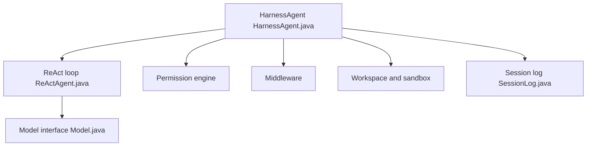

# agentscope-ai/agentscope-java

> Java 17+ framework for long-running agents with permissions, sandboxes and session resumption, for enterprise teams.

## The problem
In production, an agent must serve several tenants, run code safely and survive a rolling restart.

## What it actually does
`HarnessAgent` adds to a ReAct loop: a six-stage middleware, 32 typed events, a three-state permission engine (allow, approve, deny), sub-agents (`agent_spawn`), layered memory, context compaction, plan mode. Sandboxes: local, Docker, Kubernetes, E2B. Session state in Redis, MySQL, PostgreSQL. Models through separate modules (DashScope, OpenAI, Anthropic, Gemini, Ollama).

## How it is wired


## Trying it
```xml
<dependency>
    <groupId>io.agentscope</groupId>
    <artifactId>agentscope-harness</artifactId>
    <version>2.0.3</version>
</dependency>
```
Java example from the README: `HarnessAgent.builder()...build()` with `DASHSCOPE_API_KEY`.

## Cost and gotchas
JDK 17+. Model provider at your expense. 938 open issues: follow-up to watch. A 2.1 version is in SNAPSHOT.

## What it is not
Not the Python AgentScope SDK. "Production-ready" is the README's claim, not verified here.

## Alternatives
- Koog (JetBrains): Kotlin agent framework, same batch.

## For you
Worth watching if your stack is JVM; otherwise, a Python framework already covers these needs.
