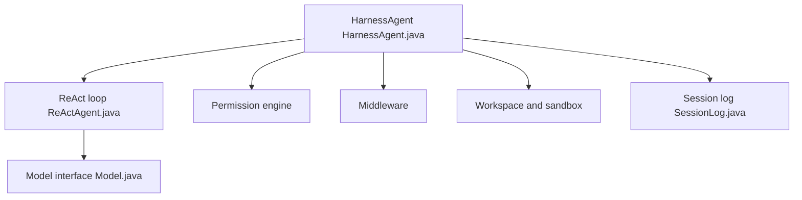

# agentscope-ai/agentscope-java

> Framework Java 17+ pour agents longue durée avec permissions, bacs à sable et reprise de session, pour équipes d'entreprise.

## Le problème
En production, un agent doit servir plusieurs locataires, exécuter du code sans danger et survivre à un redémarrage progressif.

## Ce que ça fait vraiment
`HarnessAgent` ajoute à une boucle ReAct : middleware en six étapes, 32 événements typés, moteur de permissions à trois états (autoriser, approuver, refuser), sous-agents (`agent_spawn`), mémoire en couches, compactage de contexte, mode plan. Bacs à sable : local, Docker, Kubernetes, E2B. État de session dans Redis, MySQL, PostgreSQL. Modèles via modules séparés (DashScope, OpenAI, Anthropic, Gemini, Ollama).

## Comment c'est branché


## Essayer
```xml
<dependency>
    <groupId>io.agentscope</groupId>
    <artifactId>agentscope-harness</artifactId>
    <version>2.0.3</version>
</dependency>
```
Exemple Java du README : `HarnessAgent.builder()...build()` avec `DASHSCOPE_API_KEY`.

## Coût et pièges
JDK 17+. Fournisseur de modèle à ta charge. 938 issues ouvertes : suivi à surveiller. Une version 2.1 est en SNAPSHOT.

## Ce que ce n'est pas
Pas le SDK Python AgentScope. « Production-ready » est l'affirmation du README, non vérifiée ici.

## Alternatives
- Koog (JetBrains) : framework Kotlin d'agents, même lot.

## Pour toi
À surveiller si ta stack est JVM ; sinon, un framework Python couvre déjà ces besoins.

