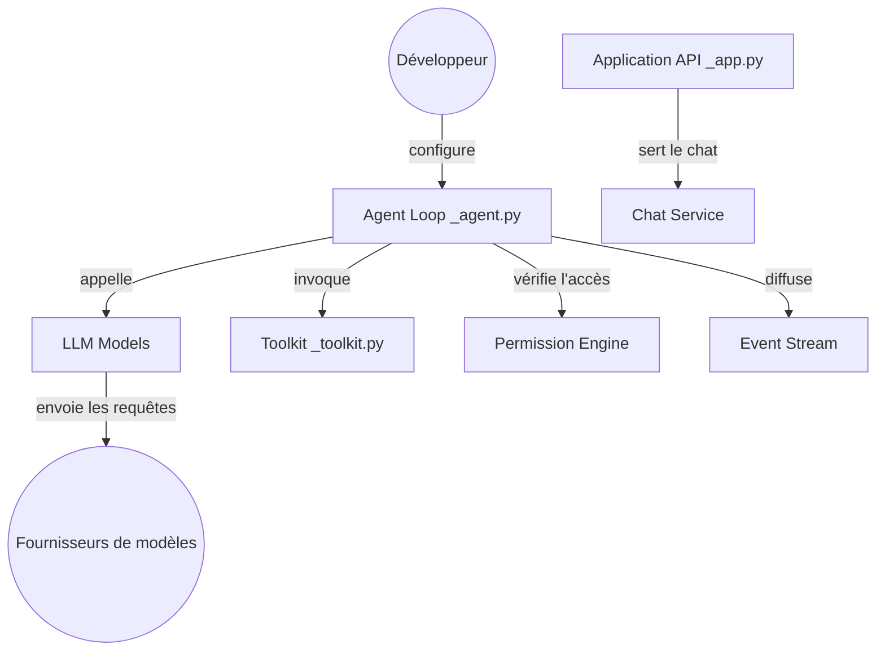

# agentscope-ai/agentscope

> Python framework for building LLM agents with tools, memory and a multi-user application service.

## The problem
Assembling an agent loop with tools, permissions, memory and an interface means stitching together many pieces with no common framework.

## What it actually does
An SDK with a ReAct loop, a toolbox (Python tools, MCP servers, skills, code tools), models from several providers, middlewares, a permission engine with human confirmation, memory (ReMe, Mem0) and sandboxes (Docker, E2B, K8s…). A FastAPI "agent service" with a web interface adds multi-tenancy, channels (Feishu, Discord), RAG, scheduling and persistence. Version 2.0 bets on capable models rather than rigid prompts.

## How it is wired


## Trying it
```bash
uv pip install agentscope
git clone -b main https://github.com/agentscope-ai/agentscope.git
cd agentscope/examples/agent_service
python main.py
```

## Cost and gotchas
Python 3.11 or later. You need the API key of at least one provider (the example uses DashScope). The web interface requires pnpm. Moving from 1.0 to 2.0 changes the API.

## What it is not
It is not an evaluation or observability platform. The shell and file-editing tools give the agent real access to the machine: to be supervised.

## Alternatives
No alternative named in the README.

## For you
Worth watching if you build agents in Python; the competitive field is crowded, but the provided application service saves you from writing much glue.
