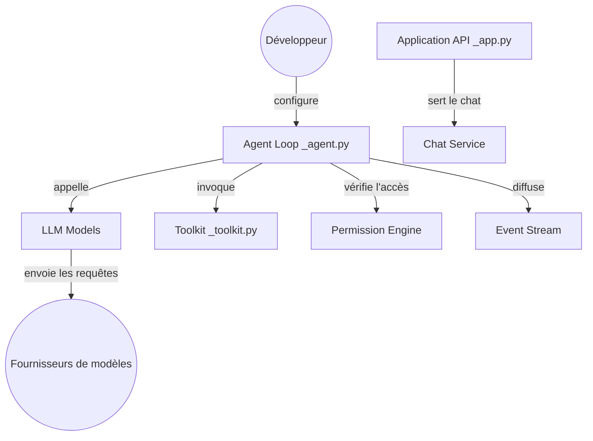

# agentscope-ai/agentscope

> Framework Python pour construire des agents LLM avec outils, mémoire et un service applicatif multi-utilisateurs.

## Le problème
Assembler une boucle d'agent avec outils, permissions, mémoire et interface oblige à recoller de nombreuses briques sans cadre commun.

## Ce que ça fait vraiment
Un SDK avec boucle ReAct, boîte à outils (outils Python, serveurs MCP, skills, outils de code), modèles de plusieurs fournisseurs, middlewares, moteur de permissions avec confirmation humaine, mémoire (ReMe, Mem0) et bacs à sable (Docker, E2B, K8s…). Un « agent service » FastAPI avec interface web ajoute multi-tenance, canaux (Feishu, Discord), RAG, planification et persistance. La 2.0 mise sur des modèles capables plutôt que sur des prompts rigides.

## Comment c'est branché


## Essayer
```bash
uv pip install agentscope
git clone -b main https://github.com/agentscope-ai/agentscope.git
cd agentscope/examples/agent_service
python main.py
```

## Coût et pièges
Python 3.11 ou plus. Il faut la clé d'API d'au moins un fournisseur (l'exemple utilise DashScope). L'interface web demande pnpm. Le passage de la 1.0 à la 2.0 modifie l'API.

## Ce que ce n'est pas
Ce n'est pas une plateforme d'évaluation ni d'observabilité. Les outils de shell et d'édition de fichiers donnent à l'agent un accès réel à la machine : à encadrer.

## Alternatives
Aucune alternative nommée dans le README.

## Pour toi
À surveiller si tu construis des agents en Python ; le champ concurrentiel est encombré, mais le service applicatif fourni évite d'écrire beaucoup de colle.

