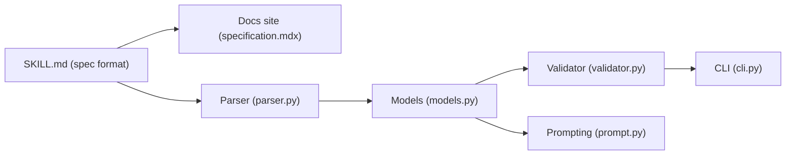

# agentskills/agentskills

> Open specification for Agent Skills: folders of know-how that AI agents load on demand.

## The problem
Agents lack task-specific context to work reliably, and every product invents its own format for reusable instructions.

## What it actually does
Defines a portable format: a folder with a `SKILL.md` (name, description, instructions) and optionally scripts, references and resources. Agents follow progressive disclosure: discovery (name and description only), activation (reading the full SKILL.md), execution. The repo contains the documentation site (specification, authoring guides, client implementation guide, client showcase) and a reference Python package `skills-ref` (parser, models, validator, prompt generation, CLI).

## How it is wired

## Trying it
The README provides no command; it points to the documentation, the specification and example skills.

## Cost and gotchas
Free. The format comes from Anthropic, published as an open standard according to the README. The Python package is a reference implementation, not an agent runtime.

## What it is not
Not an agent nor an execution library: the repo standardizes the inputs that clients load. The repo's `.claude/` directory is maintenance tooling.

## Alternatives
- No alternative named in the README.

## For you
Adopt: this is the format to know for packaging your data/MLOps know-how as skills reusable across agents, with a reference validator.
