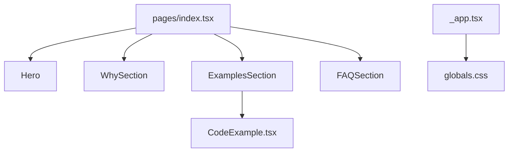

# agentsmd/agents.md

> AGENTS.md open format: a file readable by coding agents, like a README for them.

## The problem
Coding agents lack predictable project instructions (test commands, conventions, PRs).

## What it actually does
Defines the convention of an `AGENTS.md` file at the root of a project (environment tips, tests, PR rules). The repository also contains the Next.js site (agents.md) that presents the format, examples and an FAQ. No backend.

## How it is wired


## Trying it
```bash
pnpm install
pnpm run dev
```
Then open http://localhost:3000 (site only).

## Cost and gotchas
Free, no heavy prerequisites. Nothing to install to adopt the format: creating the file is enough.

## What it is not
Not an executable tool nor a specification imposed on all agents: the README does not list compatible agents.

## Alternatives
None named in the README.

## For you
Adopt: an `AGENTS.md` in your repositories costs almost nothing and frames agents around your test commands.
