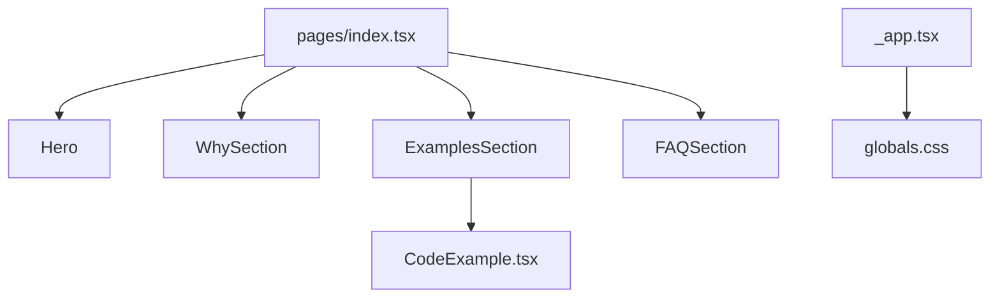

# agentsmd/agents.md

> Format ouvert AGENTS.md : un fichier lisible par les agents de codage, comme un README pour eux.

## Le problème
Les agents de code manquent de consignes projet prévisibles (commandes de test, conventions, PR).

## Ce que ça fait vraiment
Définit la convention d'un fichier `AGENTS.md` à la racine d'un projet (astuces d'environnement, tests, règles de PR). Le dépôt contient aussi le site Next.js (agents.md) qui présente le format, des exemples et une FAQ. Pas de backend.

## Comment c'est branché


## Essayer
```bash
pnpm install
pnpm run dev
```
Puis ouvrir http://localhost:3000 (site uniquement).

## Coût et pièges
Gratuit, aucun prérequis lourd. Il n'y a rien à installer pour adopter le format : créer le fichier suffit.

## Ce que ce n'est pas
Pas un outil exécutable ni une spécification imposée à tous les agents : le README ne liste pas les agents compatibles.

## Alternatives
Aucune nommée dans le README.

## Pour toi
À adopter : un `AGENTS.md` dans tes dépôts coûte presque rien et cadre les agents sur tes commandes de test.

