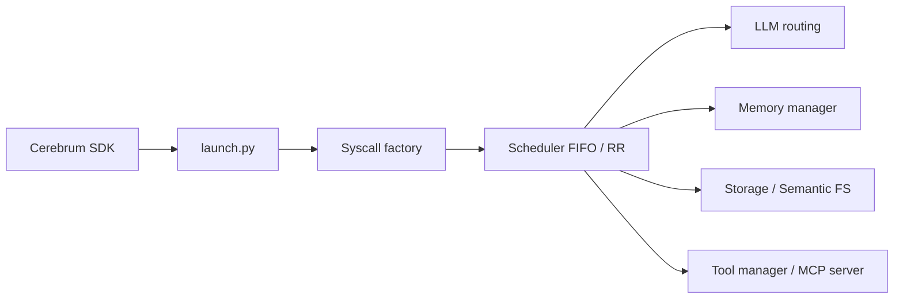

# agiresearch/AIOS

> Research kernel for an "operating system for LLM agents": scheduling, memory, storage, tools.

## The problem
Several agents sharing an LLM, memory and tools step on each other without scheduling or resource management.

## What it actually does
A server (Uvicorn) receiving agent "syscalls" through the Cerebrum SDK, scheduled FIFO or round-robin.
Subsystems: LLM routing (OpenAI, Anthropic, Ollama, vLLM, HuggingFace...), memory (in-house, Mem0, Zep), storage and a semantic file system.
Tool manager with an MCP server and virtual machines for computer-use agents.
Natural-language terminal; experimental Rust port.

## How it is wired


## Trying it
```bash
git clone https://github.com/agiresearch/AIOS.git
pip install -r requirements.txt
git clone https://github.com/agiresearch/Cerebrum.git
cd Cerebrum && pip install -e .
bash runtime/launch_kernel.sh
python scripts/run_terminal.py
```

## Cost and gotchas
API keys or a local GPU (vLLM, Linux GPU); Python 3.10-3.11 only; Redis for terminal rollback.
Deployment modes 3 and 4 are not yet available.

## What it is not
Not a real operating system: a Python layer on top of the OS.
Not a mature agent framework for production.

## Alternatives
No alternative named in the README.

## For you
Ignore in practice: an academic research project to follow through its papers, not a building block to integrate; license to check.
