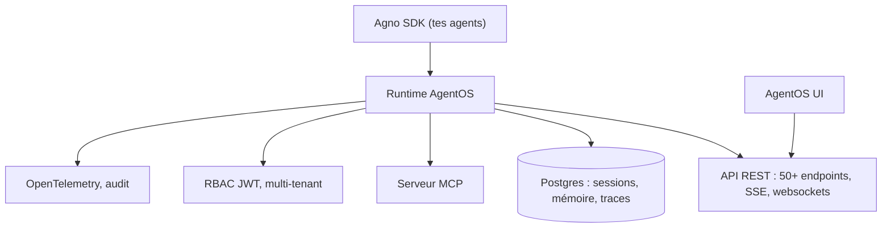

# agno-agi/agno

> Framework and runtime for hosting your own agent platform, API and console included.

## The problem
Going from an agent running in a notebook to a multi-user service requires an API,
storage, authentication, traces and monitoring — everything you would otherwise write by hand.

## What it actually does
Three building blocks: the Agno SDK to build, the AgentOS runtime to serve, the AgentOS
interface to administer. Exposes more than 50 endpoints with SSE and websockets.
Stores sessions, memory, knowledge and traces in your own database. Provides JWT-based RBAC and
multi-user/multi-tenant isolation, human approval with pausing of a run,
and blocking of tools that require administrator consent.
Brings more than 100 integrations (GitHub, Slack, Postgres), Context Providers to live data,
OpenTelemetry tracing, exposure through Slack, Telegram, WhatsApp, Discord, A2A,
and cron scheduling without external infrastructure.

## How it is wired


## Trying it
```text
Help me set up my agent platform.

Clone https://github.com/agno-agi/agentos-railway into a folder called
agent-platform, cd in, read the README, and follow the get started guide.
```

## Cost and gotchas
The framework is free; the infrastructure (containers, Postgres) and the models are at your expense.
The recommended start goes through a coding agent that clones a template repo — there is one
template per deployment target. Telemetry is enabled by default: one event per agent run,
to be turned off with `AGNO_TELEMETRY=false`; the README claims that prompts and outputs
are not transmitted.

## What it is not
It is not a ready-to-use agent: it is the scaffolding around yours. It is not
a managed service, everything runs on your side. The README gives no direct code example,
it points to templates.

## Alternatives
No alternative named in the README.

## For you
Worth a look the day an agent has to leave the notebook with authentication and traces.
