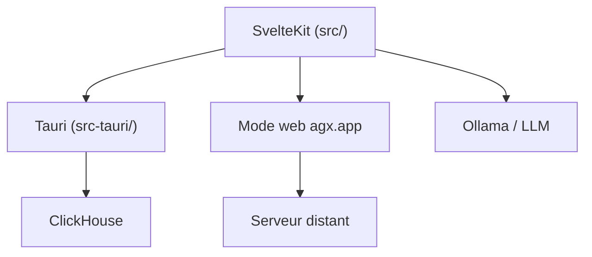

# agx

> Tauri desktop application to explore and query data in SQL on ClickHouse, with an LLM.

## The problem
Exploring data requires a SQL editor, a schema browser and a chart, often in separate tools.

## What it actually does
- SQL editor with syntax highlighting, schema browser, results in a table.
- Drag-and-drop of files; LLM integration (local Ollama possible).
- Two modes: native application with embedded ClickHouse, or web interface connected to a remote server.
- Bonus features with "Agnostic" ClickHouse UDFs.

## How it is wired
Simplified diagram based on the sheet, no diagram provided.


## Trying it
```bash
git clone https://github.com/agnosticeng/agx && cd agx
docker compose up
# http://localhost:8080
OLLAMA_ORIGINS="https://app.agx" ollama serve
```

## Cost and gotchas
Free. Building requires Node 16 or later, Rust and Tauri's system dependencies. The UDF script is installed with `curl ... | sh`: read it before running it.

## What it is not
Not a data warehouse: it relies on ClickHouse. How the LLM module works is not described in the README.

## Alternatives
No alternative mentioned in the README.

## For you
Worth watching if you use ClickHouse: a local SQL client with an LLM can speed up exploration, but the README says too little to decide.
