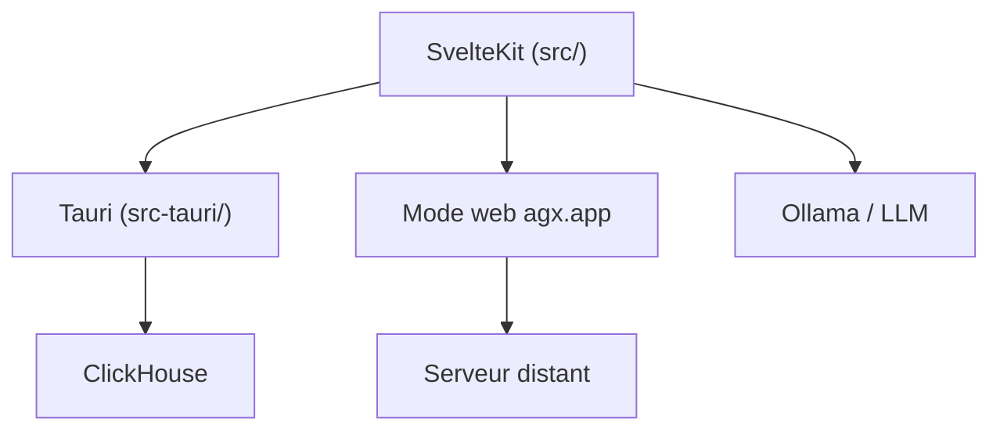

# agx

> Application de bureau Tauri pour explorer et interroger des données en SQL sur ClickHouse, avec LLM.

## Le problème
Explorer des données demande un éditeur SQL, un navigateur de schéma et un graphique, souvent dans des outils séparés.

## Ce que ça fait vraiment
- Éditeur SQL avec coloration, navigateur de schéma, résultats en tableau.
- Glisser-déposer de fichiers ; intégration d'un LLM (Ollama en local possible).
- Deux modes : application native avec ClickHouse embarqué, ou interface web reliée à un serveur distant.
- Fonctions bonus avec des UDF ClickHouse « Agnostic ».

## Comment c'est branché
Schéma simplifié d'après la fiche, sans diagramme fourni.


## Essayer
```bash
git clone https://github.com/agnosticeng/agx && cd agx
docker compose up
# http://localhost:8080
OLLAMA_ORIGINS="https://app.agx" ollama serve
```

## Coût et pièges
Gratuit. Compiler demande Node 16 ou plus, Rust et les dépendances système de Tauri. Le script d'UDF s'installe par `curl ... | sh` : le relire avant de l'exécuter.

## Ce que ce n'est pas
Pas un entrepôt de données : il s'appuie sur ClickHouse. Le fonctionnement du module LLM n'est pas décrit dans le README.

## Alternatives
Aucune alternative citée dans le README.

## Pour toi
À surveiller si tu utilises ClickHouse : un client SQL local avec LLM peut accélérer l'exploration, mais le README en dit trop peu pour trancher.

