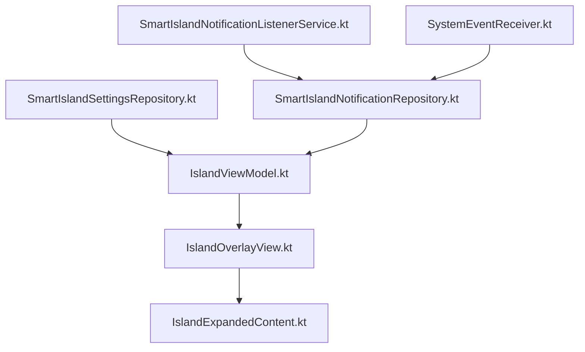

# agupta07505/SmartIsland

> Privacy-respecting Android overlay that displays notifications, media and calls around the camera cutout.

## The problem
On Android, the camera cutout and the status bar do not show ongoing activities in a compact, interactive way.

## What it actually does
A pill around the cutout shows notifications, music, calls, timers, navigation and system events, and expands into a card on touch. At rest, it cycles through clock, weather, network speed. The README says everything stays on the device, with no account or analytics; the unlock animation is still under construction.

## How it is wired


## Trying it
```bash
git clone https://github.com/agupta07505/SmartIsland.git
cd SmartIsland
./gradlew assembleDebug
adb install -r app/build/outputs/apk/debug/app-debug.apk
```

## Cost and gotchas
Free. You need the Android SDK (API 26 to 36), JDK 17 and the Gradle wrapper; the application asks for extensive permissions (overlay, notification access). GPL-3.0 license.

## What it is not
Not a development or data tool. Work is still in progress (unlock in phases) and the project dates from July 2026.

## Alternatives
No alternative named in the README.

## For you
Ignore: an Android interface gadget unrelated to data, AI or MLOps.
