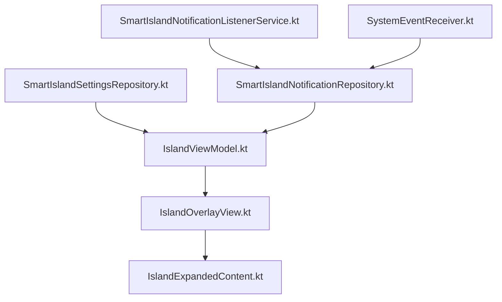

# agupta07505/SmartIsland

> Surcouche Android respectueuse de la vie privée qui affiche notifications, médias et appels autour de la découpe caméra.

## Le problème
Sur Android, la découpe caméra et la barre d'état n'affichent pas les activités en cours de manière compacte et interactive.

## Ce que ça fait vraiment
Une pastille autour de la découpe montre notifications, musique, appels, minuteurs, navigation et événements système, et s'ouvre en carte au toucher. Au repos, elle fait tourner horloge, météo, vitesse réseau. Le README dit que tout reste sur l'appareil, sans compte ni analyse ; l'animation de déverrouillage est encore en construction.

## Comment c'est branché


## Essayer
```bash
git clone https://github.com/agupta07505/SmartIsland.git
cd SmartIsland
./gradlew assembleDebug
adb install -r app/build/outputs/apk/debug/app-debug.apk
```

## Coût et pièges
Gratuit. Il faut le SDK Android (API 26 à 36), JDK 17 et le wrapper Gradle ; l'application demande des permissions étendues (superposition, accès aux notifications). Licence GPL-3.0.

## Ce que ce n'est pas
Ce n'est pas un outil de développement ni de data. Les travaux restent en cours (déverrouillage par phases) et le projet date de juillet 2026.

## Alternatives
Aucune alternative nommée dans le README.

## Pour toi
À ignorer : gadget d'interface Android sans rapport avec la data, l'IA ou le MLOps.

