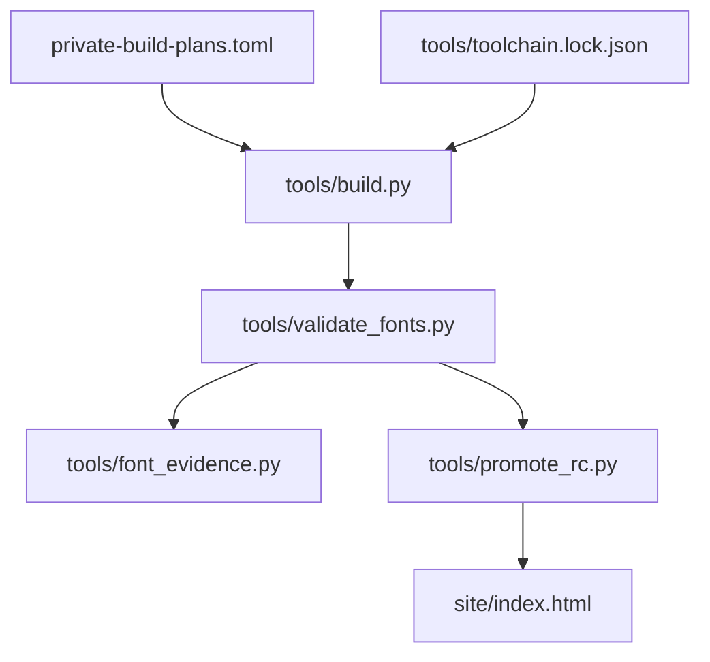

# ahatem/IoskeleyMono

> Free monospace font derived from Iosevka, for editors and terminals, in three families.

## The problem
Pleasant coding fonts are often paid (Berkeley Mono) or force ligatures that cannot be disabled.

## What it actually does
Provides ten weights, two widths, upright and italic, in three families: Standard, Term (terminals) and NL (no ligatures). Nerd Font variants and WOFF2 web archives. Built from Iosevka via `private-build-plans.toml`, validated by scripts before publication.

## How it is wired


## Trying it
```bash
brew install --cask font-ioskeley-mono
fc-cache -fv
```
The second command applies to Linux after copying into `~/.local/share/fonts/IoskeleyMono/`.

## Cost and gotchas
Free, OFL-1.1 license. Choose hinted or unhinted depending on the screen. The spelling of the name must be entered exactly in the editor.

## What it is not
Not a clone of Berkeley Mono: the README says so. Not a ligature font in the NL family.

## Alternatives
Iosevka, the base of the project; Berkeley Mono, commercial, cited as inspiration.

## For you
Adopt: two minutes of installation for a clean coding font in notebooks, terminal and VS Code.
