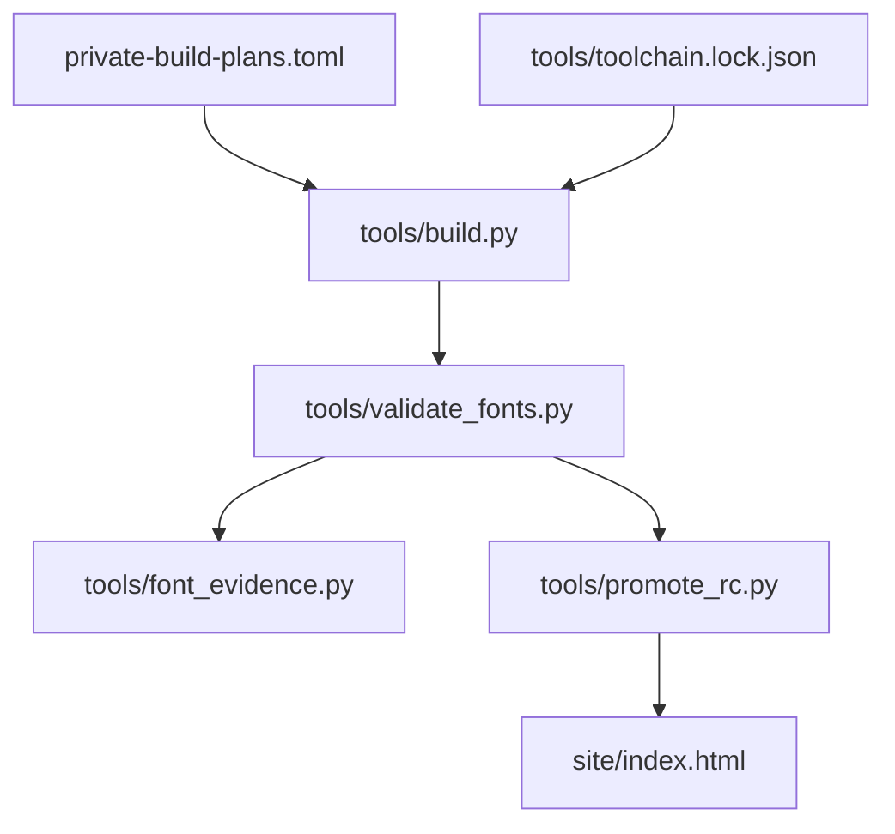

# ahatem/IoskeleyMono

> Police monospace libre dérivée d'Iosevka, pour éditeurs et terminaux, en trois familles.

## Le problème
Les polices de code agréables sont souvent payantes (Berkeley Mono) ou imposent des ligatures qu'on ne peut pas désactiver.

## Ce que ça fait vraiment
Fournit dix graisses, deux largeurs, droit et italique, en trois familles : Standard, Term (terminaux) et NL (sans ligatures). Variantes Nerd Font et archives web WOFF2. Construite depuis Iosevka via `private-build-plans.toml`, validée par scripts avant publication.

## Comment c'est branché


## Essayer
```bash
brew install --cask font-ioskeley-mono
fc-cache -fv
```
La seconde commande vaut pour Linux après copie dans `~/.local/share/fonts/IoskeleyMono/`.

## Coût et pièges
Gratuit, licence OFL-1.1. Choisir hinted ou unhinted selon l'écran. La graphie du nom est à saisir exactement dans l'éditeur.

## Ce que ce n'est pas
Pas un clone de Berkeley Mono : le README le dit. Pas une police à ligatures dans la famille NL.

## Alternatives
Iosevka, base du projet ; Berkeley Mono, commerciale, citée comme inspiration.

## Pour toi
Adopter : deux minutes d'installation pour une police de code propre en notebooks, terminal et VS Code.

