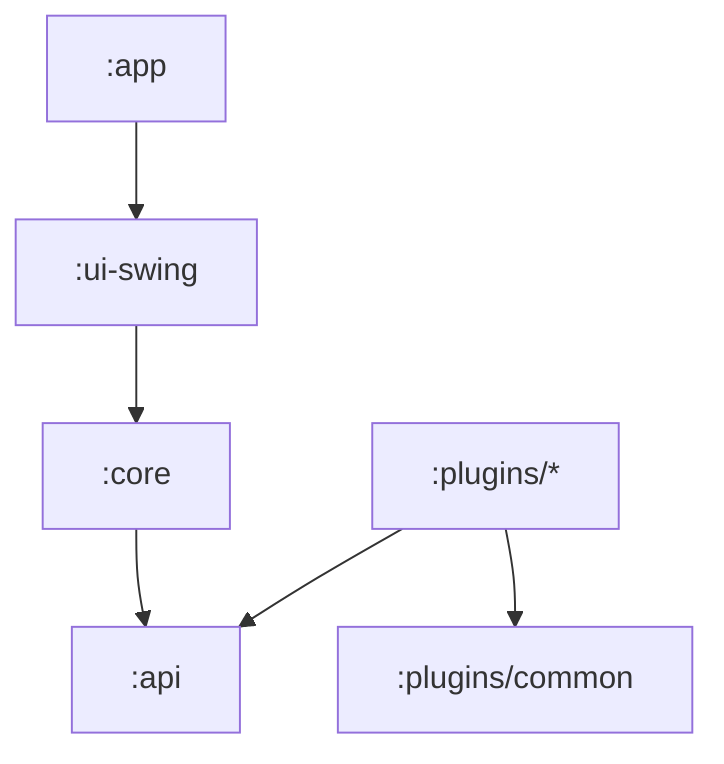

# ahatem/QTranslate

> Desktop translator with a keyboard shortcut and plugins, a rewrite of the abandoned QTranslate, for readers and researchers.

## The problem
Understand text selected in any application without switching windows, and without depending on a single translation service.

## What it actually does
Ctrl+Q translates the selected text in a popup. Document translation (DOCX, PDF, TXT, SRT, VTT), screen OCR, spell checking, comparison of several translators, CSV dictionary. Engines, OCR and speech synthesis are JAR plugins that can be installed on the fly; AI goes through OpenRouter or a local server (Ollama, LM Studio).

## How it is wired


## Trying it
```bash
java -jar QTranslate.jar
```
On Windows: extract `QTranslate-<version>-windows-x64.zip` and run `QTranslate.exe`.

## Cost and gotchas
Free; Java 17+ on macOS and Linux. Some free translators are unofficial endpoints, subject to change. Third-party plugins run with local access: only install them from trusted sources.

## What it is not
It is not a translation service: it goes through external providers that receive your text, unless you point it to a local server.

## Alternatives
The original QTranslate (Questsoft) is cited as an abandoned project.

## For you
Worth watching: useful day to day for reading foreign documentation, with a local option so nothing is sent to the cloud.
