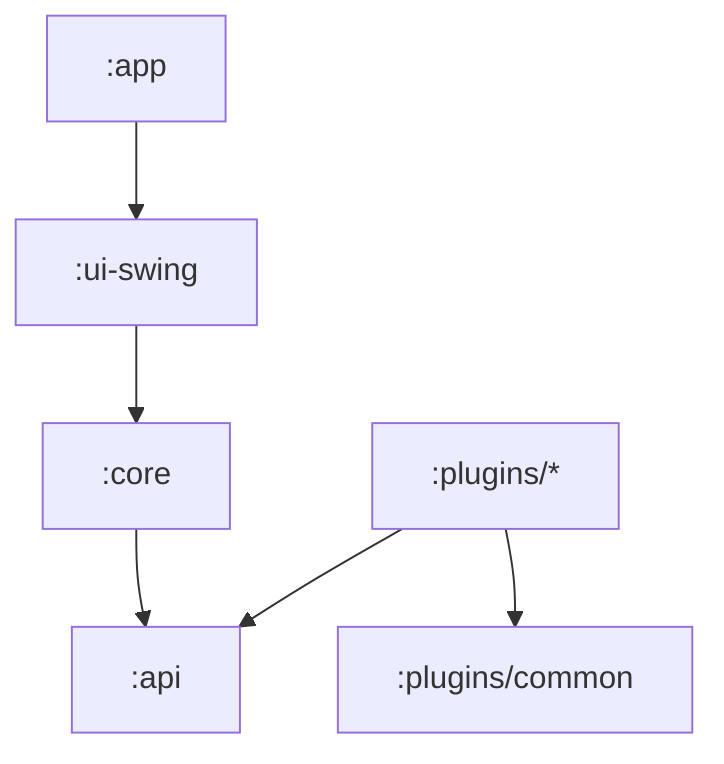

# ahatem/QTranslate

> Traducteur de bureau à raccourci clavier avec plugins, réécriture du QTranslate abandonné, pour lecteurs et chercheurs.

## Le problème
Comprendre un texte sélectionné dans n'importe quelle application sans changer de fenêtre, et sans dépendre d'un seul service de traduction.

## Ce que ça fait vraiment
Ctrl+Q traduit le texte sélectionné dans une popup. Traduction de documents (DOCX, PDF, TXT, SRT, VTT), OCR d'écran, correction orthographique, comparaison de plusieurs traducteurs, dictionnaire CSV. Moteurs, OCR et synthèse vocale sont des plugins JAR installables à chaud ; l'IA passe par OpenRouter ou un serveur local (Ollama, LM Studio).

## Comment c'est branché


## Essayer
```bash
java -jar QTranslate.jar
```
Sous Windows : extraire `QTranslate-<version>-windows-x64.zip` et lancer `QTranslate.exe`.

## Coût et pièges
Gratuit ; Java 17+ sur macOS et Linux. Certains traducteurs gratuits sont des points d'accès non officiels, sujets à changement. Les plugins tiers s'exécutent avec accès local : à n'installer que de sources fiables.

## Ce que ce n'est pas
Ce n'est pas un service de traduction : il passe par des fournisseurs externes qui reçoivent ton texte, sauf si tu pointes vers un serveur local.

## Alternatives
Le QTranslate d'origine (Questsoft) est cité comme projet abandonné.

## Pour toi
À surveiller : utile au quotidien pour lire de la documentation étrangère, avec option locale pour ne rien envoyer dans le cloud.

