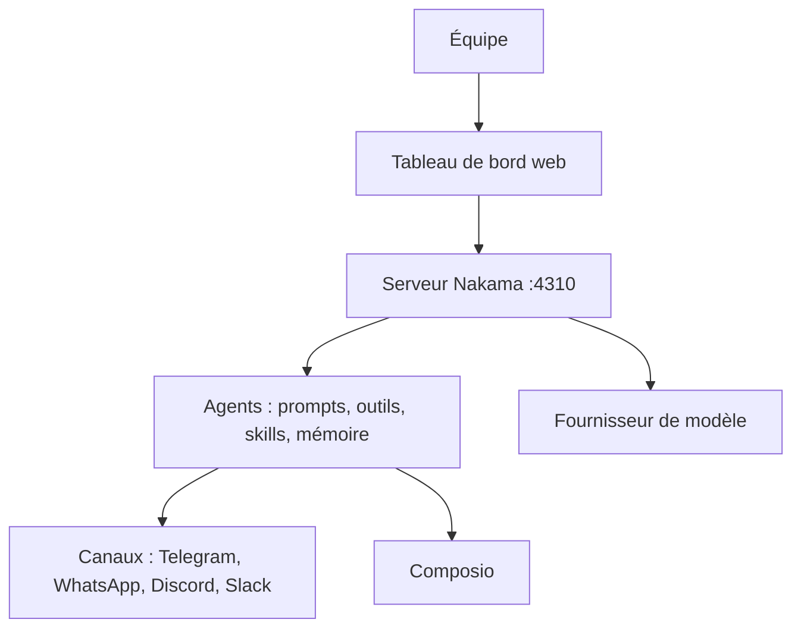

# ahmadrosid/nakama

> Multi-team AI agent platform with a chat dashboard, tools, memory and messaging channels.

## The problem
Running several AI agents for a team, with separate identities, permissions and memory, means gluing together many pieces by hand.

## What it actually does
A single server hosts several organizations, with invitations and roles. Each agent has its own prompt files, tools, skills and memory. You talk to it in a web dashboard or via Telegram, WhatsApp, Discord and Slack. Composio opens access to more than 1,000 external applications.

## How it is wired
Simplified diagram based on the sheet, no diagram provided.



## Trying it
```bash
bun install
bun run dev:web
# ou en Docker
docker pull ghcr.io/ahmadrosid/nakama:latest
docker run -d -p 4310:4310 -v nakama-data:/nakama/data --env-file nakama-secrets.env --name nakama ghcr.io/ahmadrosid/nakama:latest
```

## Cost and gotchas
On first launch, the server asks for a provider and an API key: the model bill is on you. Back up `NAKAMA_SECRETS_KEY`: backups do not include it. A hosted offer exists, pricing not documented here.

## What it is not
It is not a model nor a research framework: it is an agent management application. No Windows install link published for the desktop. A young project (created in May 2026), with 45 open issues.

## Alternatives
- OpenClaw: cited by the README as an equivalent class of capability, but designed for a single operator.
- Hermes Agent: same remark, one operator on one machine.

## For you
Worth watching: it answers a real need for team-shared agents, but it is recent, run by one person, and no production feedback is documented.
