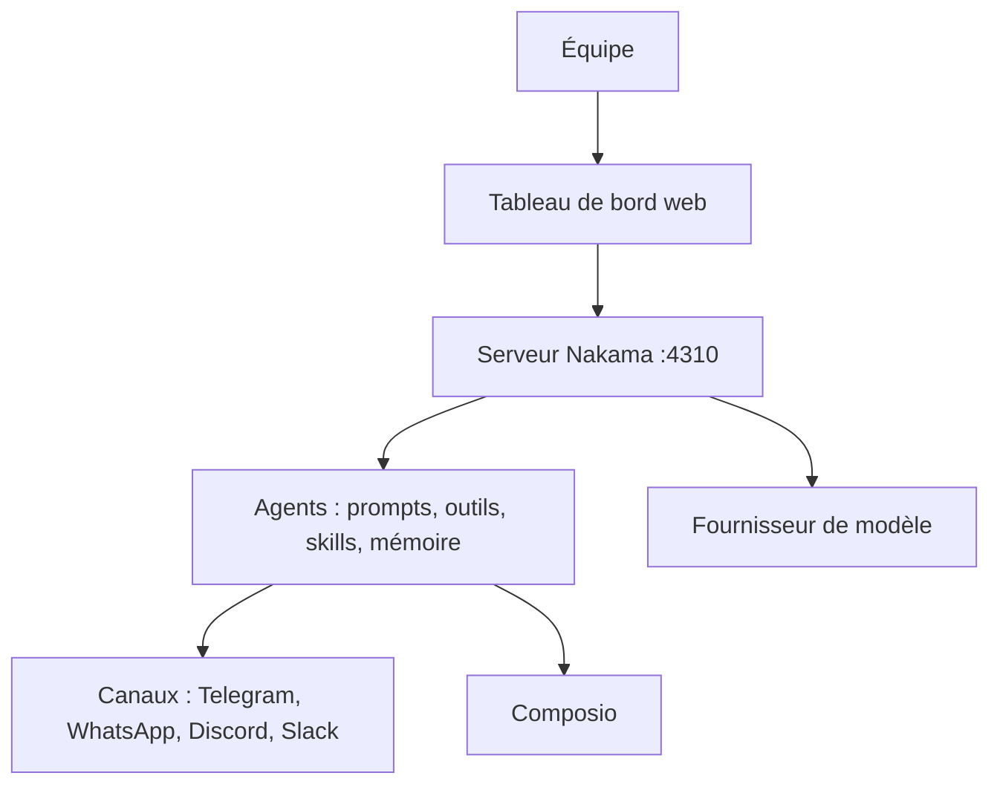

# ahmadrosid/nakama

> Plateforme d'agents IA multi-équipes avec tableau de bord de chat, outils, mémoire et canaux de messagerie.

## Le problème
Faire tourner plusieurs agents IA pour une équipe, avec identités, droits et mémoire séparés, demande de recoller beaucoup de briques à la main.

## Ce que ça fait vraiment
Un serveur unique héberge plusieurs organisations, avec invitations et rôles. Chaque agent a ses fichiers de prompt, ses outils, ses skills et sa mémoire. On discute avec lui dans un tableau de bord web ou via Telegram, WhatsApp, Discord et Slack. Composio ouvre l'accès à plus de 1 000 applications externes.

## Comment c'est branché
Schéma simplifié d'après la fiche, sans diagramme fourni.



## Essayer
```bash
bun install
bun run dev:web
# ou en Docker
docker pull ghcr.io/ahmadrosid/nakama:latest
docker run -d -p 4310:4310 -v nakama-data:/nakama/data --env-file nakama-secrets.env --name nakama ghcr.io/ahmadrosid/nakama:latest
```

## Coût et pièges
Au premier lancement, le serveur demande un fournisseur et une clé d'API : la facture des modèles est à ta charge. Sauvegarde `NAKAMA_SECRETS_KEY` : les sauvegardes ne l'incluent pas. Une offre hébergée existe, tarif non documenté ici.

## Ce que ce n'est pas
Ce n'est pas un modèle ni un framework de recherche : c'est une application de gestion d'agents. Pas de lien Windows d'installation publié pour le bureau. Projet jeune (créé en mai 2026), avec 45 issues ouvertes.

## Alternatives
- OpenClaw : cité par le README comme classe de capacité équivalente, mais pensé pour un seul opérateur.
- Hermes Agent : même remarque, un opérateur sur une machine.

## Pour toi
À surveiller : il répond à un vrai besoin d'agents partagés en équipe, mais il est récent, porté par une seule personne, et aucun retour de production n'est documenté.

