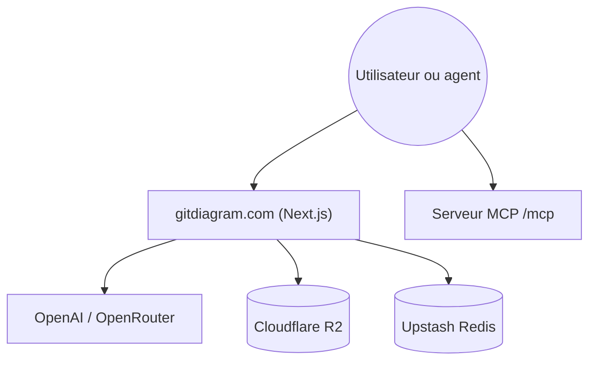

# ahmedkhaleel2004/gitdiagram

> Turns a GitHub repository into an interactive architecture diagram, or a short narrated video, through a website and an MCP.

## The problem
Understanding the architecture of an unfamiliar repository means reading dozens of files.

## What it actually does
The site generates a Mermaid diagram and an explanation with AI, with links to the files. There is a remote MCP server (`https://gitdiagram.com/mcp`, no key), a Markdown version of each diagram and explainer videos (early access). Private repositories go through a GitHub token. Self-hosting requires Cloudflare R2, Upstash Redis and an OpenAI or OpenRouter key.

## How it is wired

Diagram drawn from the README, no diagram provided.

## Trying it
```bash
claude mcp add --transport http gitdiagram https://gitdiagram.com/mcp
git clone https://github.com/ahmedkhaleel2004/gitdiagram.git
cd gitdiagram
bun install
cp .env.example .env
bun run dev
```

## Cost and gotchas
The public site is usable without a key. Locally, you need Bun, R2, Redis and a model key at your own expense. The videos require three additional keys.

## What it is not
Not a static analysis of the code: the diagram is an LLM's interpretation, sometimes incomplete. The diagrams provided in this watch come from it.

## Alternatives
- Gitingest: cited as a source of inspiration.

## For you
Adopt to get oriented quickly in a repository: the MCP requires no key, and the risks are limited to the accuracy of the diagram.
