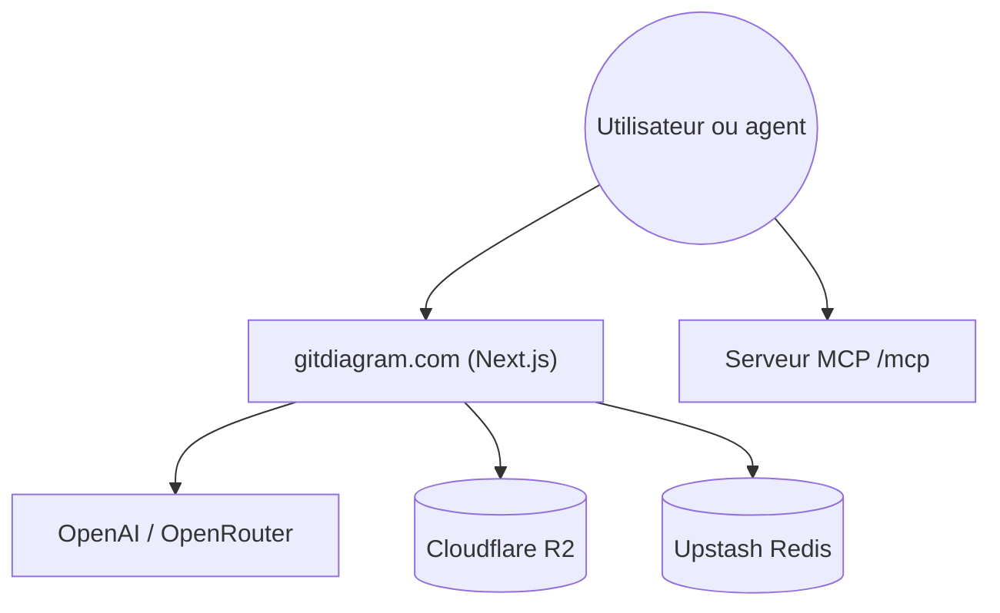

# ahmedkhaleel2004/gitdiagram

> Transforme un dépôt GitHub en diagramme d'architecture interactif, ou en courte vidéo narrée, via un site et un MCP.

## Le problème
Comprendre l'architecture d'un dépôt inconnu oblige à lire des dizaines de fichiers.

## Ce que ça fait vraiment
Le site génère par IA un diagramme Mermaid et une explication, avec des liens vers les fichiers. Il existe un serveur MCP distant (`https://gitdiagram.com/mcp`, sans clé), une version Markdown de chaque diagramme et des vidéos explicatives (accès anticipé). Les dépôts privés passent par un token GitHub. L'auto-hébergement exige Cloudflare R2, Upstash Redis et une clé OpenAI ou OpenRouter.

## Comment c'est branché

Schéma tiré du README, aucun diagramme fourni.

## Essayer
```bash
claude mcp add --transport http gitdiagram https://gitdiagram.com/mcp
git clone https://github.com/ahmedkhaleel2004/gitdiagram.git
cd gitdiagram
bun install
cp .env.example .env
bun run dev
```

## Coût et pièges
Le site public est utilisable sans clé. En local, il faut Bun, R2, Redis et une clé de modèle à ta charge. Les vidéos demandent trois clés supplémentaires.

## Ce que ce n'est pas
Pas une analyse statique du code : le diagramme est une interprétation d'un LLM, parfois incomplète. Les diagrammes fournis dans cette veille en sont issus.

## Alternatives
- Gitingest : cité comme source d'inspiration.

## Pour toi
À adopter pour s'orienter vite dans un dépôt : le MCP ne demande aucune clé, et les risques se limitent à l'exactitude du diagramme.

