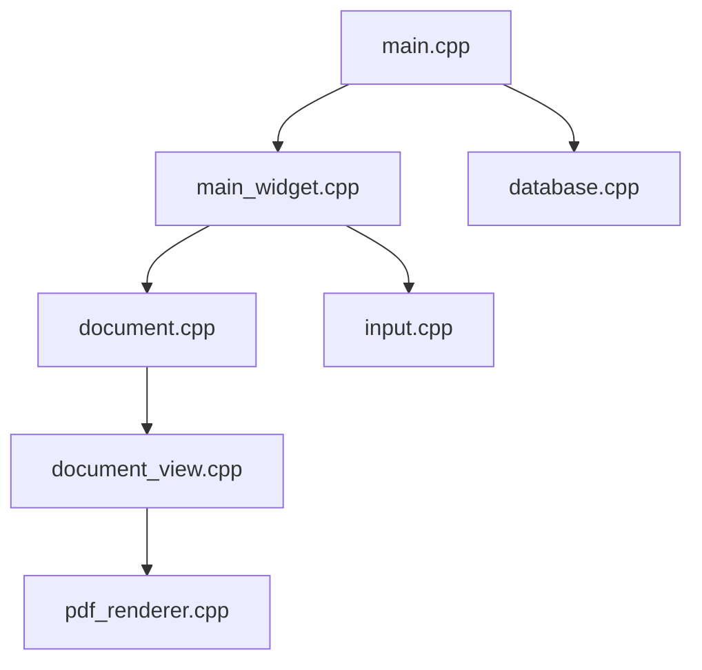

# ahrm/sioyek

> PDF reader for textbooks and research papers, with smart jumps to figures and references.

## The problem
Reading a paper means constantly going back to a distant figure, definition or bibliographic reference.

## What it actually does
Jumps to a reference or figure even without links in the PDF, opens a preview on right-click, sets marks and bookmarks, highlights, and shows a linked destination in a second window (portals). Everything is configured through config files, with no heavy interface.

## How it is wired



## Trying it
```bash
brew install --cask sioyek
git clone --recursive --branch development https://github.com/ahrm/sioyek
cd sioyek
./build_linux.sh
```

## Cost and gotchas
Free, GPL-3.0 license. The development branch requires Qt 6.7 or 6.8; on macOS, a "damaged" message comes from quarantine. Third-party Linux packages are at your own risk.

## What it is not
Not a bibliography management or collaborative annotation tool: everything stays local.

## Alternatives
No alternative named in the README.

## For you
Worth watching: useful for reading many AI research papers; remains a comfort choice, not a pipeline tool.
