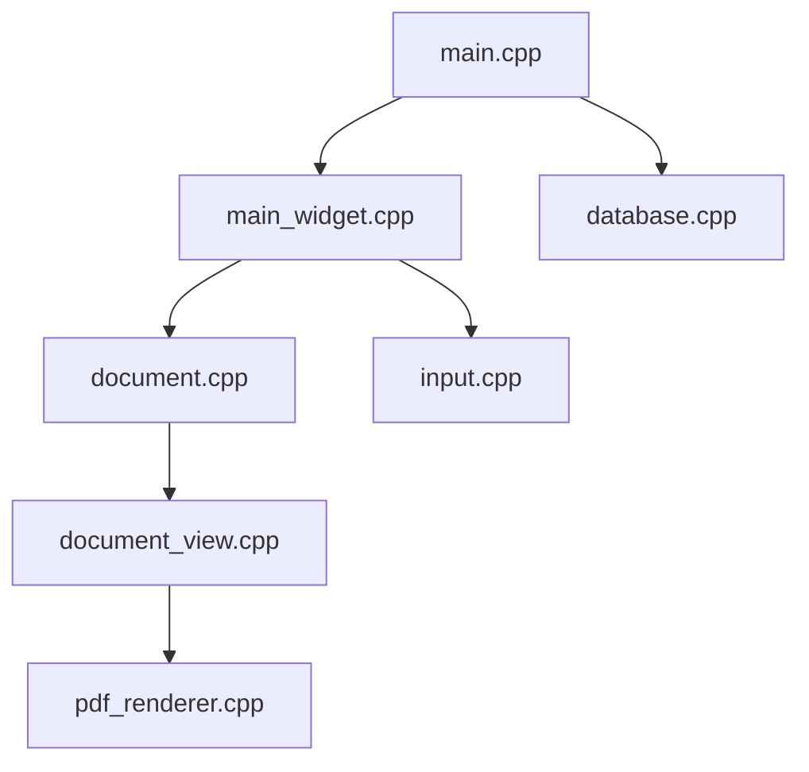

# ahrm/sioyek

> Lecteur PDF pour manuels et articles de recherche, avec sauts intelligents vers figures et références.

## Le problème
Lire un article, c'est revenir sans cesse vers une figure, une définition ou une référence bibliographique éloignée.

## Ce que ça fait vraiment
Saute vers une référence ou une figure même sans liens dans le PDF, ouvre un aperçu au clic droit, pose des marques et signets, surligne, et affiche une destination liée dans une seconde fenêtre (portails). Tout se règle par fichiers de configuration, sans interface lourde.

## Comment c'est branché



## Essayer
```bash
brew install --cask sioyek
git clone --recursive --branch development https://github.com/ahrm/sioyek
cd sioyek
./build_linux.sh
```

## Coût et pièges
Gratuit, licence GPL-3.0. La branche de développement demande Qt 6.7 ou 6.8 ; sur macOS, un message « endommagé » vient de la quarantaine. Les paquets Linux tiers sont à tes risques.

## Ce que ce n'est pas
Pas un outil de gestion bibliographique ni d'annotation collaborative : tout reste local.

## Alternatives
Aucune alternative nommée dans le README.

## Pour toi
À surveiller : utile pour lire beaucoup d'articles de recherche en IA ; reste un choix de confort, pas un outil de pipeline.

