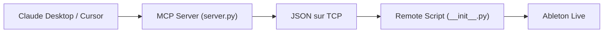

# ahujasid/ableton-mcp

> MCP server that lets Claude drive Ableton Live: tracks, MIDI clips, instruments, arrangement.

## The problem
Composing in Ableton means manipulating the interface by hand; here you describe the track and the AI acts.

## What it actually does
Two parts: a Remote Script installed in Ableton (a socket server) and a Python MCP server (`server.py`) that speaks JSON over TCP. It can create tracks and clips, write notes, load instruments and effects, set the tempo, start playback and build a complete arrangement. Ableton Live 10+ is required.

## How it is wired


## Trying it
```bash
uvx --from ableton-mcp ableton-mcp-install-script
claude mcp add AbletonMCP uvx ableton-mcp
export ABLETON_MCP_DISABLE_TELEMETRY=true
```

## Cost and gotchas
You must own Ableton Live. Telemetry is enabled by default and also covers prompts, MIDI notes, track names and settings; it can be disabled with an environment variable. Only one server instance at a time (Cursor or Claude Desktop).

## What it is not
Not a music generator: it drives existing software. Complex arrangements must be split into steps (a limit stated in the README).

## Alternatives
Not documented in the README.

## For you
Ignore: the music domain is outside your profile, and default telemetry sends prompts, which outweighs the curiosity value.
