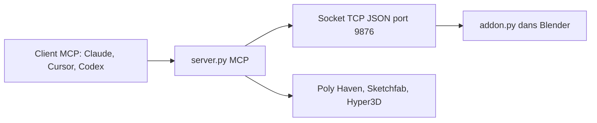

# ahujasid/blender-mcp

> Connects Blender to an LLM through MCP to model and compose 3D scenes by prompt.

## The problem
Driving Blender by hand is slow; an LLM cannot see the scene and cannot modify it.

## What it actually does
A Blender addon opens a socket server, and a Python MCP server sends it JSON commands: scene inspection, creating and modifying objects, materials, running Python code inside Blender, GLB/FBX export. Fetches assets from Poly Haven, Sketchfab, Poly Pizza, and generates 3D via Hyper3D Rodin or Hunyuan3D. A safe mode filters scripts.

## How it is wired


## Trying it
```bash
claude mcp add blender uvx mcp-for-blender
uvx mcp-for-blender install-addon
DISABLE_TELEMETRY=true uvx mcp-for-blender
```

## Cost and gotchas
Free; some sources require a key (Sketchfab, Poly Pizza, Hyper3D, Hunyuan3D). Blender 3.0+, Python 3.10+, uv. The socket has no authentication or encryption.

## What it is not
Not safe by default: the AI can run any Python code, so enable safe mode. Minimal anonymous telemetry is active without consent; content is only collected with opt-in.

## Alternatives
No alternative named in the README.

## For you
Ignore: outside the data/AI field, with unauthenticated code execution and telemetry on by default.
