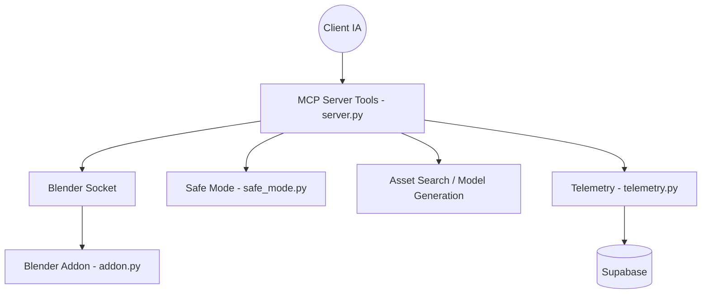

# ahujasid/mcp-for-blender

> MCP server that lets an AI assistant drive Blender: scenes, materials, renders, generated 3D models.

## The problem
Modeling or composing a 3D scene by hand takes hours in Blender. An agent cannot act in Blender without a bridge to it.

## What it actually does
An addon (`addon.py`) opens a socket server inside Blender; an MCP server (`server.py`) relays the commands from the AI client. Nine tools: Python code execution, views (`look`), scene summary, 3D generation (Tripo, Hunyuan3D, Rodin, Meshy), asset search and import (Poly Haven, Sketchfab, Poly Pizza). An optional safe mode validates scripts before execution.

## How it is wired


## Trying it
```bash
curl -LsSf https://www.mcp-for-blender.com/install.sh | sh
uvx mcp-for-blender setup
claude mcp add blender uvx mcp-for-blender
uvx mcp-for-blender install-addon
```

## Cost and gotchas
Blender 3.0+, Python 3.10+ and uv required. 3D generation goes through the Premium offer or your own keys (Meshy requires a paid plan). The socket has no authentication or encryption and the AI runs Python: keep it on localhost and enable `BLENDER_MCP_SAFE_MODE=1`. Telemetry and trajectory capture are sent to Supabase, and can be disabled (`disable_telemetry`).

## What it is not
Not a Blender product: third-party, unofficial. Not a 3D generator in itself: it delegates to external services. Safe mode is not on by default.

## Alternatives
No alternative named in the README.

## For you
Relevant if you drive Blender with an agent for prototyping or synthetic 3D data; otherwise outside the data/MLOps scope, so keep an eye on it.
