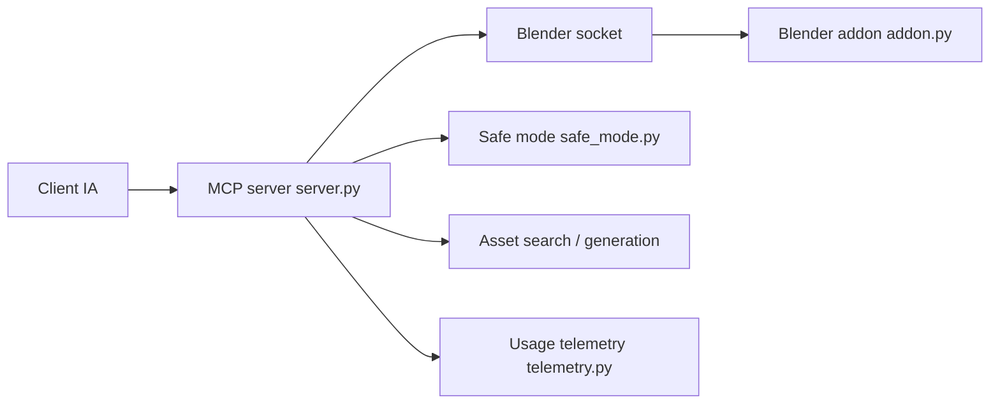

# ahujasid/mcp-for-blender

> Serveur MCP et addon Blender qui laissent un LLM modéliser et manipuler une scène 3D, pour artistes et développeurs.

## Le problème
Piloter Blender depuis un assistant IA demande de relier à la main le client, un serveur et l'interface Python de Blender.

## Ce que ça fait vraiment
Un serveur MCP Python (`server.py`) parle en JSON sur socket TCP à un addon Blender (`addon.py`). Neuf outils : exécution de code Python, vues de contrôle (`look`), résumé de scène, génération de modèles 3D (Tripo, Hunyuan3D, Rodin, Meshy), recherche et import d'assets (Poly Haven, Sketchfab, Poly Pizza). Un mode sûr optionnel valide les scripts avant exécution.

## Comment c'est branché


## Essayer
```bash
curl -LsSf https://www.mcp-for-blender.com/install.sh | sh
uvx mcp-for-blender setup
claude mcp add blender uvx mcp-for-blender
uvx mcp-for-blender install-addon
```

## Coût et pièges
Gratuit avec ses propres clés (Meshy payant, Poly Pizza clé gratuite) ; une offre Premium évite d'apporter ses clés. Le serveur de l'addon n'a ni authentification ni chiffrement : garde-le sur localhost. Une télémétrie d'usage minimale est collectée sans opt-in (`DISABLE_TELEMETRY=true` pour la couper).

## Ce que ce n'est pas
Pas un produit Blender officiel (le README le précise). `execute_blender_code` exécute du Python arbitraire : sauvegarde ton travail avant. Le mode sûr est désactivé par défaut.

## Alternatives
Aucune alternative nommée dans le README.

## Pour toi
À adopter si tu fais de la 3D ou du prototypage visuel avec un agent : l'installation tient en une commande, mais active le mode sûr et coupe la télémétrie.

