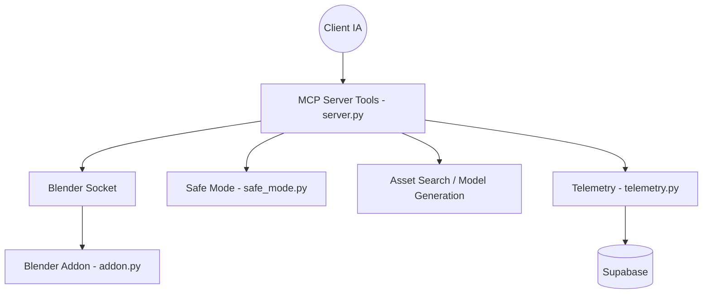

# ahujasid/mcp-for-blender

> Serveur MCP qui laisse un assistant IA piloter Blender : scènes, matériaux, rendus, modèles 3D générés.

## Le problème
Modéliser ou composer une scène 3D à la main demande des heures dans Blender. Un agent ne peut pas agir dans Blender sans pont vers lui.

## Ce que ça fait vraiment
Un addon (`addon.py`) ouvre un serveur socket dans Blender ; un serveur MCP (`server.py`) relaie les commandes du client IA. Neuf outils : exécution de code Python, vues (`look`), résumé de scène, génération 3D (Tripo, Hunyuan3D, Rodin, Meshy), recherche et import d'assets (Poly Haven, Sketchfab, Poly Pizza). Un mode sûr optionnel valide les scripts avant exécution.

## Comment c'est branché


## Essayer
```bash
curl -LsSf https://www.mcp-for-blender.com/install.sh | sh
uvx mcp-for-blender setup
claude mcp add blender uvx mcp-for-blender
uvx mcp-for-blender install-addon
```

## Coût et pièges
Blender 3.0+, Python 3.10+ et uv requis. La génération 3D passe par l'offre Premium ou par tes propres clés (Meshy exige un plan payant). Le socket n'a ni authentification ni chiffrement et l'IA exécute du Python : garder localhost et activer `BLENDER_MCP_SAFE_MODE=1`. Télémétrie et capture de trajectoires envoyées à Supabase, désactivables (`disable_telemetry`).

## Ce que ce n'est pas
Pas un produit Blender : tiers, non officiel. Pas un générateur 3D en soi : il délègue aux services externes. Le mode sûr n'est pas actif par défaut.

## Alternatives
Aucune alternative nommée dans le README.

## Pour toi
Pertinent si tu pilotes Blender avec un agent pour du prototypage ou de la donnée synthétique 3D ; sinon hors périmètre data/MLOps, donc à surveiller.

