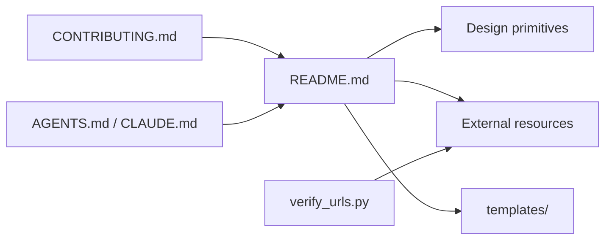

# ai-boost/awesome-harness-engineering

> Annotated list of articles, papers and repos about the harness that surrounds an AI agent, for agent engineers.

## The problem
Good practices for framing an agent (context, tools, memory, permissions, verification) are scattered across vendor blogs, papers and repos. Without a map, you rediscover the same pitfalls.

## What it actually does
The README is a commented index: each entry says why it deserves to be read. It sorts resources by harness primitive: agent loop, planning, context and compaction, tools, skills and MCP, permissions, memory, orchestration, verification, observability, debugging, human in the loop. It adds sections on reference implementations, sandboxes, evals and infrastructure. The `templates/` folder provides four Markdown templates (AGENTS, PLAN, IMPLEMENT, checklist), and `verify_urls.py` checks the links.

## How it is wired

## Trying it
No command documented in the README: the list is read directly on GitHub.

## Cost and gotchas
Free, nothing to install. The only executable tool is `verify_urls.py`, which needs a Python environment. A license is present but GitHub does not identify it: read it before reusing the templates.

## What it is not
It is neither a framework nor an executable harness: it is documentation. The comments are the maintainer's and often echo the tone of the sources ("the best", "the most complete"): check each resource. Its volume, several hundred entries, makes it a library to dig through, not a tight selection.

## Alternatives
- AutoJunjie/awesome-agent-harness: shorter list, organized into platforms, runners, runtimes and coding agents.
- Picrew/awesome-agent-harness: centered on GitHub repos, with 150 entries in nine categories.
- RyanAlberts/best-of-Agent-Harnesses: ranking of 124 harnesses, republished every week as machine-readable data.

## For you
Adopt as a reference bookmark: if you build or evaluate agents, it is the fastest way to place a tool in the landscape, without installing anything.
