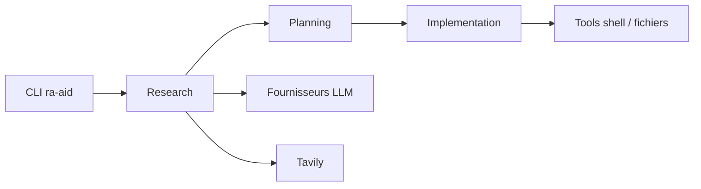

# ai-christianson/RA.Aid

> Autonomous command-line coding agent built on LangGraph: research, planning, implementation.

## The problem
Multi-step development tasks go beyond one-shot code editing: you need to explore, plan, then execute.

## What it actually does
Three-stage agent (research, planning, implementation) on LangGraph, with shell command execution, file operations, memory, Git and web search via Tavily. It can delegate editing to aider (`--use-aider`), query a separate "expert" model, and offers a human-in-the-loop mode, a chat and an alpha web server. Providers: Anthropic (default), OpenAI, OpenRouter, Gemini, DeepSeek, Makehub.

## How it is wired


## Trying it
```bash
pip install ra-aid
ra-aid -m "Your task or query here"
ra-aid -m "Explain the authentication flow" --research-only
```

## Cost and gotchas
API keys at your expense (`--max-cost`, `--show-cost` available). The `--cowboy-mode` runs shell commands without confirmation: a clean, versioned repo is recommended.

## What it is not
Not "fully autonomous" without supervision: the README itself asks you to review its actions. Last push 2026-01-30; the default model cited is old.

## Alternatives
- aider: can be integrated via `--use-aider`.

## For you
Keep an eye on it: one more coding agent, less followed than the main ones; useful to see the research-plan-execute pattern.
