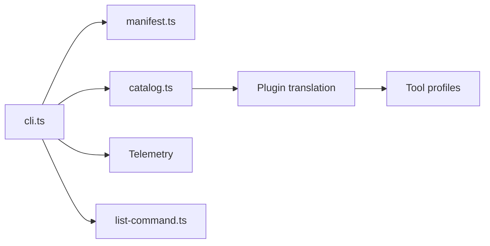

# ai-driven-dev/framework

> Plugins of skills, agents and commands that install a complete development cycle in your AI coding tool.

## The problem
Every team rewrites its own commands and rules to frame, plan, validate and review a coding agent's work.

## What it actually does
Eight plugins (about 50 skills, 2 agents) cover project context, development, VCS, product management, critical review and orchestration. The `/aidd-orchestrator:01-sdlc` command chains scoping, plan, implementation, validation, review and PR. Works natively with Claude Code, and with Cursor, Copilot, Codex and OpenCode. Node 22 is used for the hooks.

## How it is wired


## Trying it
```bash
claude plugin marketplace add ai-driven-dev/framework
claude plugin install aidd-context@aidd-framework
claude plugin install aidd-orchestrator@aidd-framework
```
Then, in the session: `/aidd-context:00-onboard`.

## Cost and gotchas
Free, but the plugins act with your permissions and some run Node hooks: read `hooks/` before installing. Telemetry (beta) is local according to the README, and can be disabled with `AIDD_TELEMETRY=0`. 71 open issues.

## What it is not
Not an agent in itself, nor a guardrail: the workflows are markdown files. The "enterprise-grade" label is their own marketing.

## Alternatives
No alternative named in the README.

## For you
Worth watching: useful for structuring an agent's work, but it imposes its own method; test a few skills before adopting the whole set.
