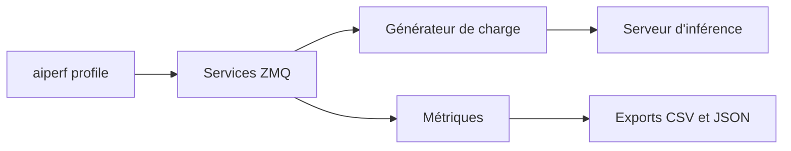

# ai-dynamo/aiperf

> NVIDIA command-line tool that measures throughput and latency of generative models served by any inference server.

## The problem
Comparing inference servers (vLLM, SGLang, TGI, NIM) requires reproducible measurements of latency, throughput and load.

## What it actually does
`aiperf profile` sends requests to an OpenAI-compatible endpoint (chat, embeddings, ranking, audio, vision, image generation) and computes TTFT, inter-token latency, per-user throughput and goodput. Load modes: concurrency, request rate, trace replay, parameter sweeps. A multiprocess architecture of 10 services communicating over ZMQ feeds three interfaces (dashboard, simple, headless). CSV and JSON exports, extras for MLflow, OpenTelemetry and Weights & Biases.

## How it is wired
Simplified diagram based on the sheet, no diagram provided.


## Trying it
```bash
python3 -m venv venv
source venv/bin/activate
pip install aiperf
aiperf profile --model "granite4:350m" --streaming --endpoint-type chat --tokenizer ibm-granite/granite-4.0-micro --url http://localhost:11434 --request-count 10
```

## Cost and gotchas
Free, but you need an inference server to measure (the example uses Ollama under Docker). Above 15,000 concurrency, risk of port exhaustion; an invalid configuration can block startup. The t-digest backend may require a C compiler.

## What it is not
Not a tool for evaluating answer quality, apart from accuracy benchmarks such as MMLU or AIME. It ships no model server. The example figures come from a CPU-only machine and are not official.

## Alternatives
No named alternative in the README (a migration guide from Genai-Perf is included).

## For you
Adopt: to size or compare inference servers, a test bench maintained by NVIDIA, with real traces and exports, is worth installing.
