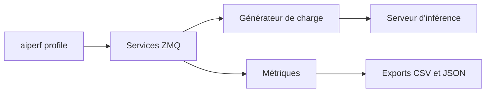

# ai-dynamo/aiperf

> Outil NVIDIA en ligne de commande qui mesure débit et latence de modèles génératifs servis par n'importe quel serveur d'inférence.

## Le problème
Comparer des serveurs d'inférence (vLLM, SGLang, TGI, NIM) exige des mesures reproductibles de latence, de débit et de charge.

## Ce que ça fait vraiment
`aiperf profile` envoie des requêtes à un endpoint compatible OpenAI (chat, embeddings, classement, audio, vision, génération d'images) et calcule TTFT, latence inter-token, débit par utilisateur et goodput. Modes de charge : concurrence, taux de requêtes, rejeu de traces, balayages de paramètres. Une architecture multiprocessus de 10 services communiquant par ZMQ alimente trois interfaces (dashboard, simple, sans écran). Exports CSV et JSON, extras MLflow, OpenTelemetry et Weights & Biases.

## Comment c'est branché
Schéma simplifié d'après la fiche, sans diagramme fourni.


## Essayer
```bash
python3 -m venv venv
source venv/bin/activate
pip install aiperf
aiperf profile --model "granite4:350m" --streaming --endpoint-type chat --tokenizer ibm-granite/granite-4.0-micro --url http://localhost:11434 --request-count 10
```

## Coût et pièges
Gratuit, mais il faut un serveur d'inférence à mesurer (l'exemple utilise Ollama sous Docker). Au-delà de 15 000 en concurrence, risque d'épuisement des ports ; une configuration invalide peut bloquer le démarrage. Le backend t-digest peut demander un compilateur C.

## Ce que ce n'est pas
Pas un outil d'évaluation de la qualité des réponses, hormis des benchmarks de précision comme MMLU ou AIME. Il n'embarque aucun serveur de modèle. Les chiffres d'exemple viennent d'une machine CPU seule et ne sont pas officiels.

## Alternatives
Aucune alternative nommée dans le README (un guide de migration depuis Genai-Perf y figure).

## Pour toi
À adopter : pour dimensionner ou comparer des serveurs d'inférence, un banc de test maintenu par NVIDIA, avec traces réelles et exports, vaut l'installation.

