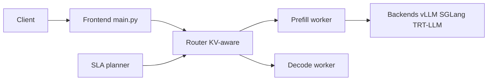

# ai-dynamo/dynamo

> NVIDIA orchestration layer on top of vLLM, SGLang and TensorRT-LLM for serving LLMs across multiple GPUs.

## The problem
An inference engine optimizes one GPU or one node. Serving a large model on a cluster requires coordinating prefill, decode, KV caches and scaling.

## What it actually does
Separates prefill and decode into independent pools, routes requests according to KV cache overlap, offloads the cache (GPU, CPU, SSD, remote storage), drives autoscaling according to SLAs. On the Kubernetes side: Grove operator, DGDR manifest. OpenAI-compatible API. Core in Rust, extensions in Python.

## How it is wired


## Trying it
```bash
docker run --gpus all --network host --rm -it nvcr.io/nvidia/ai-dynamo/vllm-runtime:1.6.0
python3 -m dynamo.frontend --http-port 8000 --discovery-backend file > /dev/null 2>&1 &
python3 -m dynamo.vllm --model Qwen/Qwen3-0.6B --discovery-backend file &
```

## Cost and gotchas
NVIDIA GPUs are essential. Kubernetes installation is recommended in production. Performance figures (7x, 750x) are provided by NVIDIA, to be verified. License present but not identified by GitHub.

## What it is not
Not an inference engine: it replaces none of them. Useless on a single GPU, as the README says.

## Alternatives
- vLLM, SGLang, TensorRT-LLM: the engines Dynamo coordinates; sufficient on a single node.

## For you
Worth watching if you operate multi-GPU LLMs in MLOps; on a single GPU, stick with the bare engine. Check the license before adoption.
