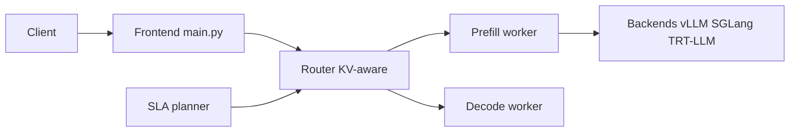

# ai-dynamo/dynamo

> Couche d'orchestration NVIDIA au-dessus de vLLM, SGLang et TensorRT-LLM pour servir des LLM sur plusieurs GPU.

## Le problème
Un moteur d'inférence optimise un GPU ou un nœud. Servir un grand modèle sur un cluster impose de coordonner préremplissage, décodage, caches KV et montée en charge.

## Ce que ça fait vraiment
Sépare préremplissage et décodage en pools indépendants, route les requêtes selon le recouvrement du cache KV, déporte le cache (GPU, CPU, SSD, stockage distant), pilote l'autoscaling selon des SLA. Côté Kubernetes : opérateur Grove, manifeste DGDR. API compatible OpenAI. Cœur en Rust, extensions en Python.

## Comment c'est branché


## Essayer
```bash
docker run --gpus all --network host --rm -it nvcr.io/nvidia/ai-dynamo/vllm-runtime:1.6.0
python3 -m dynamo.frontend --http-port 8000 --discovery-backend file > /dev/null 2>&1 &
python3 -m dynamo.vllm --model Qwen/Qwen3-0.6B --discovery-backend file &
```

## Coût et pièges
GPU NVIDIA indispensables. Installation Kubernetes recommandée en production. Chiffres de performance (7x, 750x) fournis par NVIDIA, à vérifier. Licence présente mais non identifiée par GitHub.

## Ce que ce n'est pas
Pas un moteur d'inférence : il n'en remplace aucun. Inutile sur un seul GPU, comme le dit le README.

## Alternatives
- vLLM, SGLang, TensorRT-LLM : les moteurs que Dynamo coordonne ; suffisants sur un seul nœud.

## Pour toi
À surveiller si tu opères des LLM multi-GPU en MLOps ; sur un GPU seul, reste sur le moteur nu. Vérifie la licence avant adoption.

