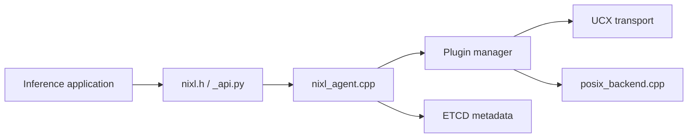

# ai-dynamo/nixl

> NVIDIA library for point-to-point transfers for AI inference, across CPU memory, GPU memory and storage.

## The problem
Distributed inference frameworks (like Dynamo) move large buffers between memories and storage with heterogeneous APIs.

## What it actually does
Provides a C++ and Python API where an application describes buffers and requests a transfer; a plugin engine executes it (UCX, Libfabric, GDS, POSIX, object, Azure Blob). Metadata via optional ETCD, telemetry and tracing included. Rust bindings, nixlbench and kvbench benchmarks.

## How it is wired


## Trying it
```bash
pip install nixl
```
```bash
meson setup <name_of_build_dir>
cd <name_of_build_dir>
ninja
ninja install
```

## Cost and gotchas
PyPI wheels target CUDA 12 and 13; building requires GCC >= 11, UCX 1.23 and meson. Proprietary NVIDIA modules are included in the wheels.

## What it is not
Not an inference server: a low-level component for those who build one. License identified as Apache-2.0 by the SPDX header but not recognized by GitHub. 253 open issues.

## Alternatives
No alternative named in the README.

## For you
Worth watching: relevant if you operate multi-GPU inference, otherwise too low-level; check the mixed license.
