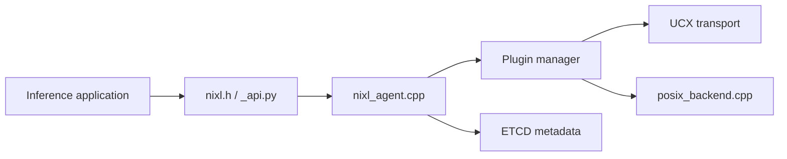

# ai-dynamo/nixl

> Bibliothèque NVIDIA de transferts point à point pour l'inférence IA, sur mémoire CPU, GPU et stockage.

## Le problème
Les frameworks d'inférence distribuée (comme Dynamo) déplacent de gros tampons entre mémoires et stockages avec des API hétérogènes.

## Ce que ça fait vraiment
Fournit une API C++ et Python où une application décrit des tampons et demande un transfert ; un moteur à plugins l'exécute (UCX, Libfabric, GDS, POSIX, objet, Azure Blob). Métadonnées via ETCD optionnel, télémétrie et traçage inclus. Bindings Rust, bancs d'essai nixlbench et kvbench.

## Comment c'est branché


## Essayer
```bash
pip install nixl
```
```bash
meson setup <name_of_build_dir>
cd <name_of_build_dir>
ninja
ninja install
```

## Coût et pièges
Les roues PyPI visent CUDA 12 et 13 ; la compilation exige GCC ≥ 11, UCX 1.23 et meson. Des modules NVIDIA propriétaires sont inclus dans les roues.

## Ce que ce n'est pas
Pas un serveur d'inférence : un composant bas niveau pour ceux qui en construisent. Licence identifiée Apache-2.0 par l'en-tête SPDX mais non reconnue par GitHub. 253 issues ouvertes.

## Alternatives
Aucune alternative nommée dans le README.

## Pour toi
À surveiller : pertinent si tu opères de l'inférence multi-GPU, sinon trop bas niveau ; vérifier la licence mixte.

