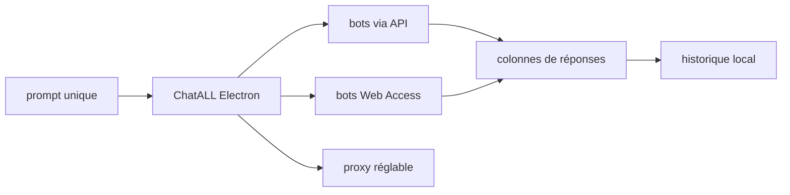

# ai-shifu/ChatALL

> Desktop client that sends the same prompt to several AI bots in parallel.

## The problem
Comparing the answers of several models means opening five tabs and pasting
the same prompt five times.

## What it actually does
Sends a prompt simultaneously to several bots and shows the answers side by side
in one, two or three columns. A "quick-prompt" mode lets you chain prompts without waiting
for the previous answer. Locally stored history, highlighting of good answers,
deletion of bad ones, enabling/disabling each bot, dark mode, shortcuts, multiple chats,
prompt management, proxy settings. Ten interface languages, Windows / macOS / Linux.

## How it is wired


## Trying it
```bash
brew install --cask chatall
npm install
npm run electron:serve
npm run electron:build
```

## Cost and gotchas
It is a client, not a proxy: you need your own accounts and API tokens for
each bot. Anonymous telemetry is enabled: which bots are queried, prompt and answer
length, deleted or highlighted answers — contents excluded.

## What it is not
Not a unified API gateway nor a reproducible benchmark. The README
warns that "Web Access" bots rely on reverse engineering of the web
interfaces, break often and are unstable: it explicitly recommends
favoring API bots.

## Alternatives
- ChatHub: cited as the project's inspiration.

## For you
Useful for an evening to pit models against each other, not a work tool. Ignore.
