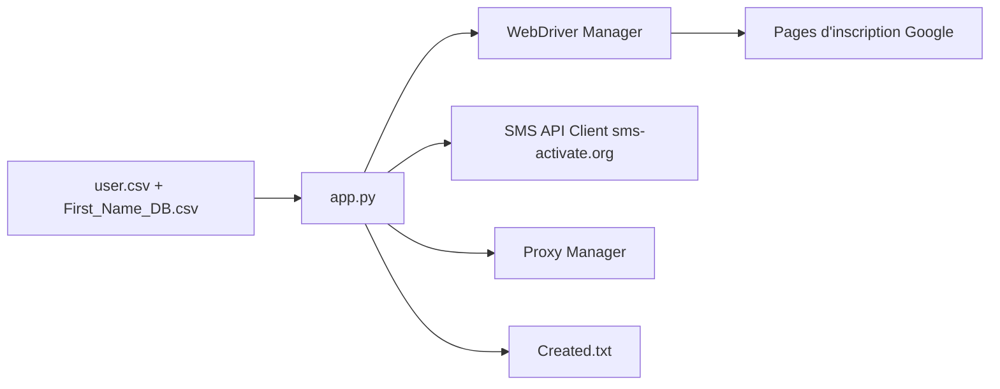

# ai-to-ai/Auto-Gmail-Creator

> Python Selenium script that creates Gmail accounts in bulk, with SMS verification and proxies.

## The problem
Creating many Google accounts by hand is slow; the script claims to automate it despite anti-bot detection.

## What it actually does
`app.py` reads or generates identities (`user.csv`, lists of first and last names), drives Chrome or Firefox via Selenium, rents a number from sms-activate.org, applies a SOCKS5 proxy and writes successful accounts to `Created.txt`. The author offers to sell a stealth webdriver in exchange for a coffee.

## How it is wired


## Trying it
```bash
pip install -r requirements.txt
python app.py
```

## Cost and gotchas
You need to pay for an SMS service and proxies; the author is himself looking for reliable, cheap providers. About five accounts per number according to the README. No commit since September 2024 and no license: nothing authorizes you to reuse the code.

## What it is not
Not a generic automation tool: its purpose is mass account creation by evading detection, which Google's terms forbid. It contains a phone number and personal contact links.

## Alternatives
No alternative named in the README.

## For you
Ignore: purpose contrary to Google's terms of use, no license, no maintenance, and unrelated to data/AI/MLOps work.
