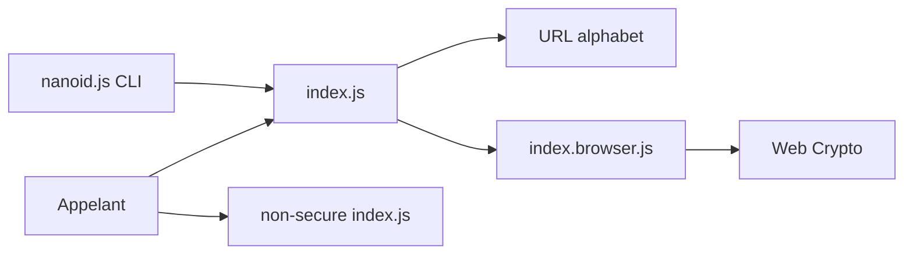

# ai/nanoid

> Generator of short, unique, URL-safe identifiers, in JavaScript.

## The problem
UUIDs are 36 characters long and `Math.random()` is not safe for identifiers.

## What it actually does
By default generates 21 characters over the `A-Za-z0-9_-` alphabet, using the system's cryptographic generator (Node crypto, Web Crypto). Configurable size and alphabet (`customAlphabet`, `customRandom`), a faster non-secure version to avoid unless needed, and a CLI. No dependencies, 127 bytes minified according to the README.

## How it is wired


## Trying it
```bash
npm install nanoid
npx nanoid
npx nanoid --size 10
npx nanoid --alphabet abc --size 15
```

## Cost and gotchas
Free. The alphabet must contain 1 to 256 symbols. Do not use it for React's `key` prop. On React Native, a polyfill for the random generator is required.

## What it is not
Not a time-ordered identifier. The call order of the generator may change between versions: no reproducible result from a seed.

## Alternatives
- crypto.randomUUID: native, slower according to the README benchmark.
- uuid v4: standard 36-character format.
- @lukeed/uuid: cited in the benchmark.

## For you
Adopt to generate run, dataset or session identifiers in JS code; small and tested.
