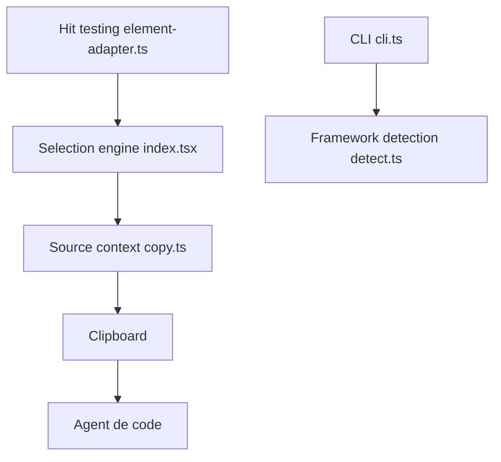

# aidenybai/react-grab

> Copies a React UI element with its component stack and source, for an agent.

## The problem
Describing to an agent which UI element to change is imprecise; it has to find the source file.

## What it actually does
You hover over an element, press Ctrl+C, and the clipboard receives the element with its component stack and source locations, to paste into the agent. A selection engine is exposed via `react-grab/primitives`. The CLI detects the framework and configures the project; a browser extension exists. The README claims agents are "2× faster", with no measurement method.

## How it is wired


## Trying it
```bash
npx grab@latest init
npm install react-grab
```

## Cost and gotchas
Free. The script is loaded from unpkg in the Next.js examples; limit it to development mode as the examples show.

## What it is not
Works for React applications only. It does not modify code, it provides context.

## Alternatives
No alternative named in the README.

## For you
Ignore: a React front-end development tool, with no link to data, AI or MLOps work.
