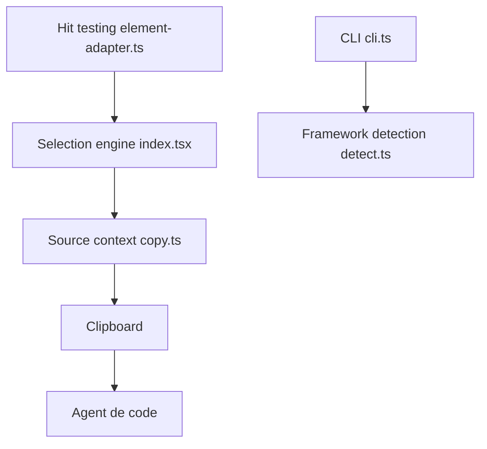

# aidenybai/react-grab

> Copie un élément d'interface React avec sa pile de composants et sa source, pour un agent.

## Le problème
Décrire à un agent quel élément de l'interface modifier est imprécis ; il doit retrouver le fichier source.

## Ce que ça fait vraiment
On survole un élément, on appuie sur Ctrl+C, et le presse-papiers reçoit l'élément avec sa pile de composants et ses emplacements de source, à coller dans l'agent. Un moteur de sélection est exposé via `react-grab/primitives`. Le CLI détecte le framework et configure le projet ; une extension navigateur existe. Le README annonce des agents « 2× plus rapides », sans méthode de mesure.

## Comment c'est branché


## Essayer
```bash
npx grab@latest init
npm install react-grab
```

## Coût et pièges
Gratuit. Le script est chargé depuis unpkg dans les exemples Next.js ; à limiter au mode développement comme le montrent les exemples.

## Ce que ce n'est pas
Fonctionne pour des applications React uniquement. Il ne modifie pas le code, il fournit du contexte.

## Alternatives
Aucune alternative nommée dans le README.

## Pour toi
À ignorer : outil de développement front React, sans lien avec un travail data, IA ou MLOps.

