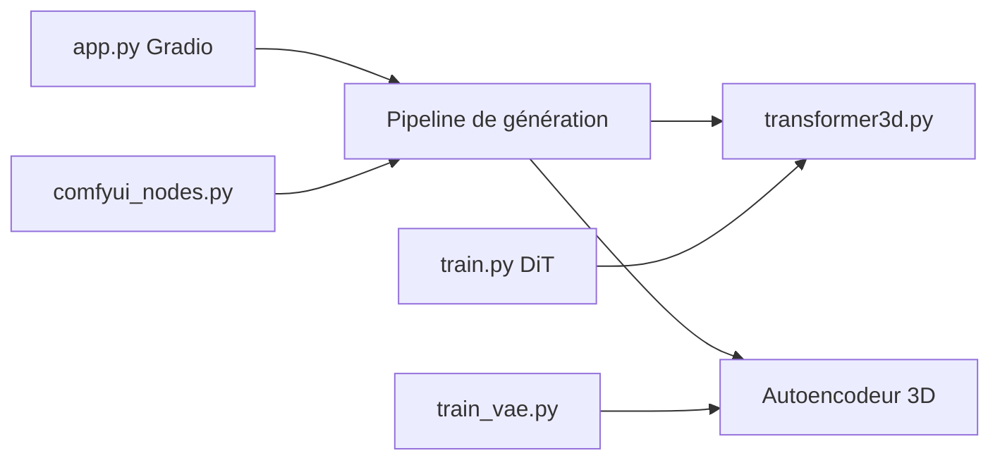

# aigc-apps/EasyAnimate

> End-to-end solution for generating long, high-resolution videos with diffusion transformers.

## The problem
Generating and customizing videos requires chaining preprocessing, VAE and DiT, with high GPU memory needs.

## What it actually does
Text, image or video to video generation (V5.1: up to 1024x1024, 49 frames, about 6 s at 8 fps), controls (Canny, pose, trajectory, camera), LoRA and DiT training, optional video VAE training, data preprocessing and captioning, reward-based optimization. Usable through a Gradio interface, Python scripts or ComfyUI; memory-saving modes through CPU offloading or float8 quantization.

## How it is wired


## Trying it
```bash
docker pull mybigpai-public-registry.cn-beijing.cr.aliyuncs.com/easycv/torch_cuda:easyanimate
git clone https://github.com/aigc-apps/EasyAnimate.git
sh scripts/train.sh
```
(The weights must be downloaded from Hugging Face or ModelScope; the README indicates launching via `predict_t2v.py` and `app.py`.)

## Cost and gotchas
About 60 GB of disk for the weights. The 12B model fits on 16 GB only with sequential offloading, which is slow; A10 24 GB: about 120 s for 384x672x25 frames. On V100 or 2080Ti, switch to float16.

## What it is not
Not an online service. Last push in March 2025; 98 open issues. The older versions V1 to V5 are flagged as obsolete.

## Alternatives
No alternative named in the README (it cites CogVideo, Open-Sora, AnimateDiff and others as starting references).

## For you
Worth watching: a reference for generating or fine-tuning videos locally, but the required hardware and the repo's slowed pace limit the interest.
