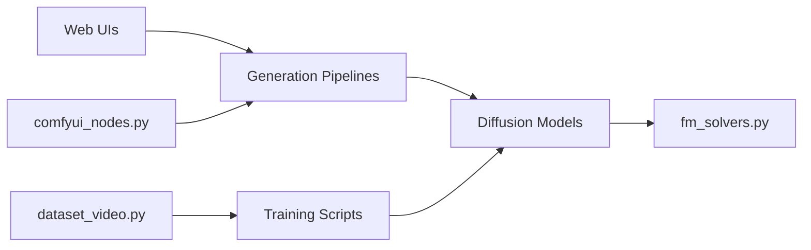

# aigc-apps/VideoX-Fun

> Toolbox to generate images and videos with diffusion transformers, and train your own LoRAs.

## The problem
Using and fine-tuning recent video models (Wan, CogVideoX, Qwen-Image, Flux...) requires gathering pipelines, weights and training scripts.

## What it actually does
Generation pipelines from text, image or video to video with control (Canny, depth, pose, camera), Gradio interface, ComfyUI nodes, multi-GPU prediction (xfuser, Ulysses/Ring). Training of models and LoRAs from a data JSON, reward LoRAs, GPU memory-saving modes (offload, qfloat8). Large catalog of weights on Hugging Face and ModelScope.

## How it is wired


## Trying it
```bash
git clone https://github.com/aigc-apps/VideoX-Fun.git
cd VideoX-Fun
mkdir models/Diffusion_Transformer
python examples/cogvideox_fun/predict_t2v.py
sh scripts/train.sh
```

## Cost and gotchas
GPU of 12 to 80 GB depending on the model, about 60 GB of disk for the weights; weights are downloaded separately.

## What it is not
Not a hosted service: everything runs on your machine. Outputs may show artifacts; the deepfake risk is flagged.

## Alternatives
Wan2.1 and Wan2.2, CogVideo, diffusers (cited in the references).

## For you
Worth watching: useful to test and fine-tune video models on your GPU, provided you have the memory and disk.
