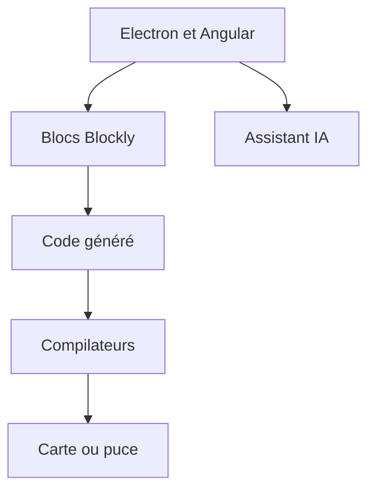

# ailyProject/aily-blockly

> Desktop Blockly IDE for electronic boards, with AI assistance, in alpha, for beginners and education.

## The problem
Programming boards and chips requires configuring toolchains, libraries and obscure error messages.

## What it actually does
An Electron and Angular IDE that manages boards and build toolchains per project (over 100 boards, over 400 libraries claimed). The AI offers project analysis, wiring diagrams, code generation, reading of compilation errors and adaptation of Arduino or C++ libraries. Compilation relies on a cloud edge cache.

## How it is wired
Simplified diagram based on the sheet, no diagram provided.


## Trying it
```bash
# Aucune commande documentée : télécharger la version Chine ou internationale depuis le README.
```

## Cost and gotchas
The software is free, GPL-3.0 with additional rights: resale forbidden without permission, notices of the rights holders must be kept. The text mentions online services and a user agreement; the terms of the AI are not detailed. Alpha version, not recommended for real work.

## What it is not
Not reliable for production firmware: the authors say so. The simulator and the interface designer are listed without description.

## Alternatives
No alternative named in the README.

## For you
Ignore: an alpha hardware-education IDE; only the angle of AI applied to embedded could be useful to you for prototyping.
