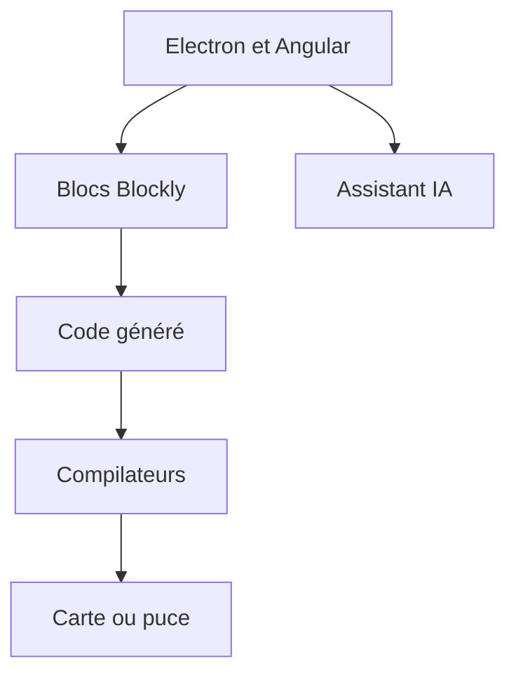

# ailyProject/aily-blockly

> IDE Blockly de bureau pour cartes électroniques, avec assistance IA, en phase alpha, pour débutants et éducation.

## Le problème
Programmer des cartes et puces demande de configurer chaînes d'outils, bibliothèques et messages d'erreur obscurs.

## Ce que ça fait vraiment
Un IDE Electron et Angular qui gère les cartes et chaînes de compilation par projet (plus de 100 cartes, plus de 400 bibliothèques annoncées). L'IA propose analyse de projet, schémas de câblage, génération de code, lecture d'erreurs de compilation et adaptation de bibliothèques Arduino ou C++. La compilation s'appuie sur un cache cloud-périphérie.

## Comment c'est branché
Schéma simplifié d'après la fiche, sans diagramme fourni.


## Essayer
```bash
# Aucune commande documentée : télécharger la version Chine ou internationale depuis le README.
```

## Coût et pièges
Le logiciel est gratuit, GPL-3.0 avec droits complémentaires : revente interdite sans autorisation, mentions des porteurs à conserver. Le texte parle de services en ligne et d'un accord d'utilisateur ; les modalités de l'IA ne sont pas détaillées. Version alpha, non conseillée pour du travail réel.

## Ce que ce n'est pas
Pas fiable pour du firmware de série : les auteurs le disent. Le simulateur et le concepteur d'interface sont listés sans description.

## Alternatives
Aucune alternative nommée dans le README.

## Pour toi
À ignorer : IDE d'éducation matérielle en alpha ; seul l'angle IA appliquée à l'embarqué pourrait te servir pour du prototypage.

