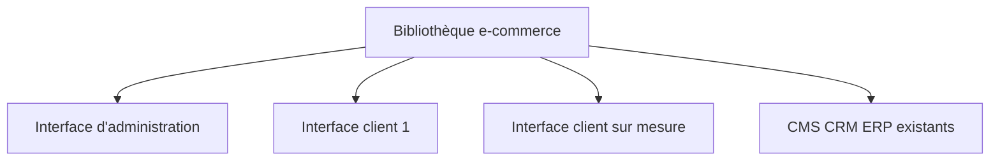

# aimeos/aimeos-core

> Modular PHP e-commerce stack (library, administration and interfaces) for medium and large shops.

## The problem
Monolithic online shops adapt poorly to existing integrations (CMS, CRM, ERP) and high volumes.

## What it actually does
The README describes a modular stack: an e-commerce library, an administration interface and several client interfaces to choose from, or to write yourself. It targets shops, catalogs, portals and marketplaces. The technical detail is not in the README: it points to the website and the documentation.

## How it is wired
Simplified diagram based on the sheet, no diagram provided.

## Trying it
No command documented in this README: installation goes through the documentation and the Composer packages indicated in the links.

## Cost and gotchas
Free according to the README, license to be verified (not identified by GitHub). A PHP environment and a database are needed, not detailed here.

## What it is not
Not a turnkey SaaS, nor a single application: it is a foundation to assemble. The "high performance" in the title is backed by no figure.

## Alternatives
No alternative named in the README.

## For you
Ignore: it is PHP e-commerce, unrelated to data or AI.
