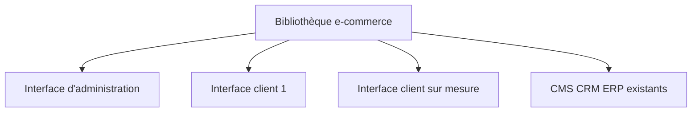

# aimeos/aimeos-core

> Pile e-commerce PHP modulaire (bibliothèque, administration et interfaces) pour boutiques moyennes et grandes.

## Le problème
Les boutiques en ligne monolithiques s'adaptent mal à des intégrations existantes (CMS, CRM, ERP) et à de forts volumes.

## Ce que ça fait vraiment
Le README décrit une pile modulaire : une bibliothèque e-commerce, une interface d'administration et plusieurs interfaces clientes au choix, ou à écrire soi-même. Il vise des boutiques, catalogues, portails et places de marché. Le détail technique n'est pas dans le README : il renvoie au site et à la documentation.

## Comment c'est branché
Schéma simplifié d'après la fiche, sans diagramme fourni.

## Essayer
Aucune commande documentée dans ce README : l'installation passe par la documentation et les paquets Composer indiqués dans les liens.

## Coût et pièges
Gratuit selon le README, licence à vérifier (non identifiée par GitHub). Il faut un environnement PHP et une base de données, non détaillés ici.

## Ce que ce n'est pas
Pas un SaaS clé en main, ni une application unique : c'est un socle à assembler. Le « high performance » du titre n'est étayé par aucun chiffre.

## Alternatives
Aucune alternative nommée dans le README.

## Pour toi
À ignorer : c'est du e-commerce PHP, sans rapport avec la donnée ou l'IA.

